## Assessment presentation and GRC report (v2.9.0)

### Contents
- [Questionnaire scrolling and focus controls](#questionnaire-scrolling-and-focus-controls-v2130)
- [Active assessment template selection](#active-assessment-template-selection-v2121)
- [Customer assessment focus mode](#customer-assessment-focus-mode)
- [Configuration](#configuration)
- [Report workflow](#report-workflow)
- [Validation](#validation)
- [Overall Maturity visibility](#overall-maturity-visibility)
- [Admin and manager color policy](#admin-and-manager-color-policy)
- [Percentage colors and opening layout](#percentage-colors-and-opening-layout)
- [Customer visibility and default-template editing](#customer-visibility-and-default-template-editing)

### Configuration
Overall Maturity is hidden by default; its new visibility mode controls whether it appears after completion or for completed sections only. Enabled maturity panels open automatically. Report starts collapsed by default, with its existing expansion preference. Summary controls support keyboard activation and existing result/report permissions still apply.

Question comments and evidence start disabled, including existing drafts. The GRC Settings `question_extras_enabled` master switch allows admins to opt in; questionnaire section/question restrictions still apply. The assessment API resolves flags on every read/save. Uploads are rejected while all question attachments are disabled. Hidden historical comments and evidence are retained; answer-only saves omit disabled fields.

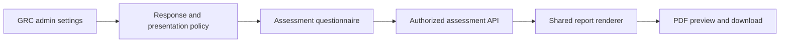

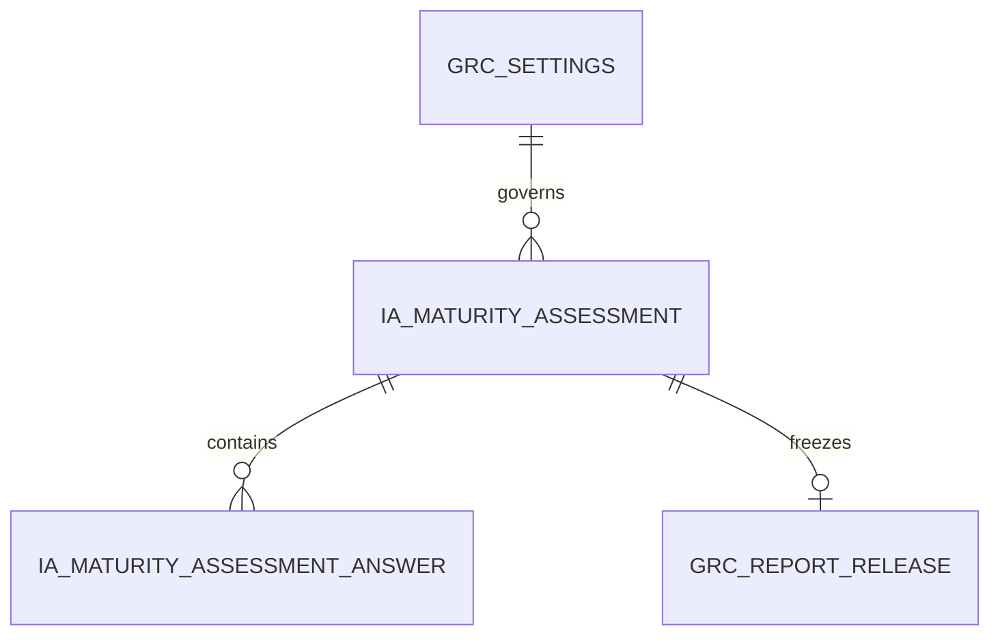

### Report workflow
The GRC reference supplies the report's typography, content hierarchy and exact palette: ink #13232F, muted #586976, teal #0E6B66, Critical #B42318, Low #BF530B, Medium #9A6F00, High #2D7A33 and Leading #1C5CA3. The A4 portrait layout places 01 Executive summary, 02 Results by section (chart/table and overall totals), and 08 Scoring method on the first page for the standard six-section assessment. Long custom content can flow onto further pages. Values and thresholds come from the versioned assessment policy.

The portal embeds the same authorized PDF endpoint used for downloading, with inline disposition. Customer delivery restrictions apply to both. Existing released PDFs and their hashes are preserved; new rendering applies to preliminary PDFs and future releases. The renderer embeds the legacy assessment's Source Serif 4, IBM Plex Sans and IBM Plex Mono fonts, with their OFL licenses included under public/fonts/report. Font rendering and pagination are verified against a fixture using the supplied reference's sample values. PDF engine differences may still affect individual glyph edges; the editable original remains useful for final pixel comparison.

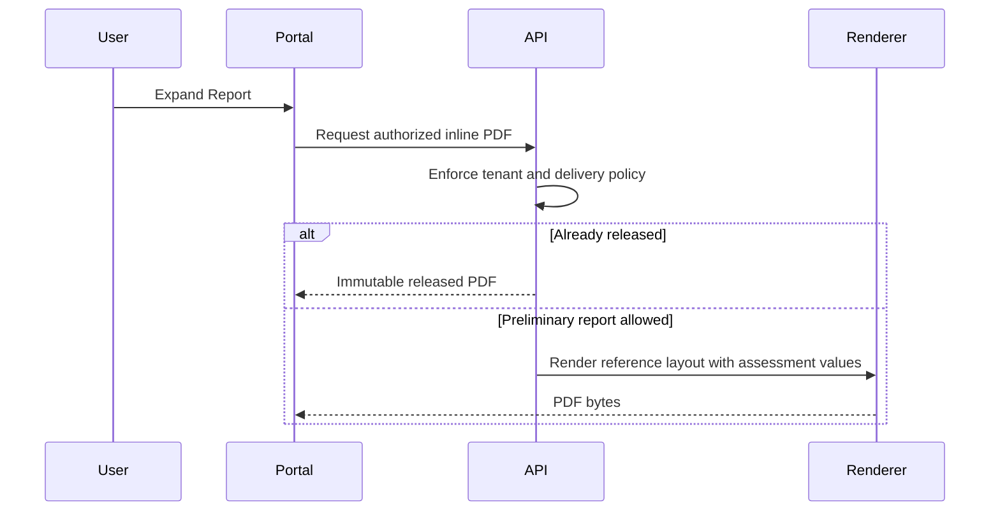

### Validation
Unit tests cover default-off policy, per-question opt-in restrictions, report escaping, landscape dimensions and pagination. Playwright tests cover disclosure toggles, admin expansion defaults, extras visibility and mobile layout. Site integration tests cover direct comment/evidence rejection, upload rejection, non-admin policy denial, historical comment preservation, tenant boundaries and release integrity.

See [README](../README.md), [Introduction](introduction.md), and [Changelog](CHANGELOG.md). After upgrading, run site migration and rebuild frontend assets with Node 24.

## Customer visibility and default-template editing

Customer section overview defaults to Always expanded, showing the section tabs immediately. The aggregate progress bar always shows answered and pending counts. Current scoring defaults to After all answers; N/A counts as attempted. GRC Settings `customer_score_timing` and `customer_sections_visibility` configure the alternatives described in the [release notes](RELEASE_v2.8.0.md). These controls govern questionnaire presentation; existing report delivery and result visibility gates still apply. Staff retain their review overview.

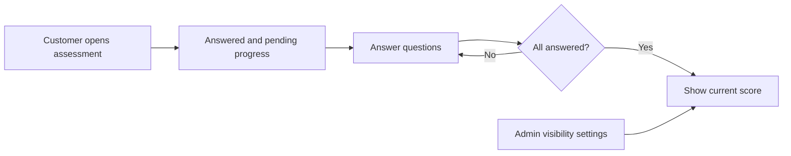

New template and inheritance defaults disable extras. Existing explicit template policies are retained; the master switch continues to gate them. Default-template revisions reset extras to disabled, and the admin may explicitly configure them.

The `templates` API marks and orders the current default. `save_template(clone=1)` creates a draft, and `publish_template(make_default=1)` publishes and updates IA Maturity Settings.default_template under admin authorization. `grc_default_revision` preselects the publication checkbox. Direct mutation of published content remains rejected. Active published templates can be selected as defaults; inactive ones are rejected.

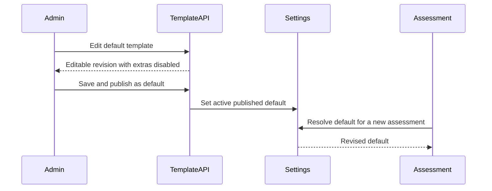

## Percentage colors and opening layout

The built-in defaults in `public/section-color-ranges.json` are shared by the frontend and Python report style layer. A saved admin/manager policy takes precedence. Only section colors use the percentage ranges; maturity labels and stored policies retain their original meaning. Exactly 100 is blue, 75–<100 green, 50–<75 orange, below 50 red. Overall maturity color remains tied to its maturity classification. Report SVG bars use capsule radii; frontend progress tracks use rounded clipping.

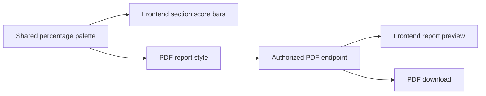

The opening page shows section tabs by default. Maturity and Report use compact disclosure rows with keyboard-operable summaries and explicit Expand/Collapse actions. Results remain gated by scoring/authorization controls. `ia_maturity.patches.v2_9.assessment_opening` upgrades the prior completion-only overview default; explicit hidden/collapsed overrides are retained. [Upgrade and validation notes](RELEASE_v2.9.0.md).

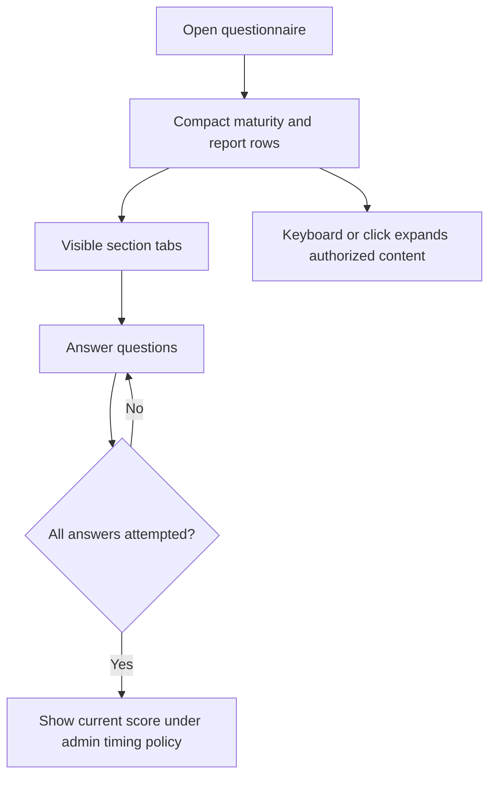

## Admin and manager color policy

Open Report color ranges in the staff sidebar. GRC App Admin and GRC Manager can add, remove and color any number of ranges. The former four-range policy remains the default. The editor shows start percentages, a color picker/hex input and previews. Upper bounds are derived from the next start to avoid gaps and overlap; the last bound is 100 inclusive. See [v2.10.0](RELEASE_v2.10.0.md).

GRC Settings.section_color_ranges stores validated JSON. Dedicated `color_ranges` and `save_color_ranges` APIs enforce role access, validate coverage/boundaries/hex colors, lock writes, compare revisions and log changes. Manager access does not grant general Settings writes. `sectionScoreColor` and `report_style.section_score_color` consume the same ranges; assessment payloads carry current ranges or a released report snapshot.

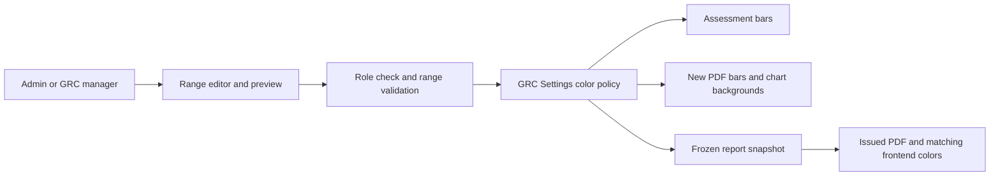

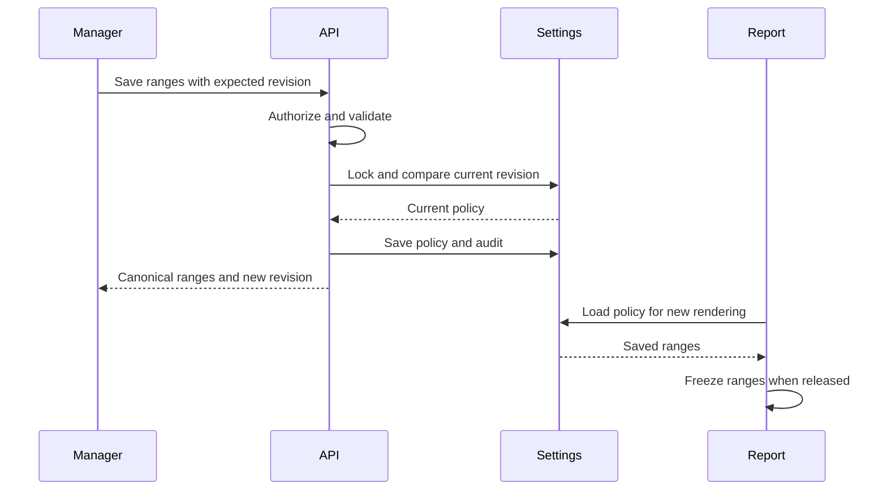

## Overall Maturity visibility

`GRC Settings.overall_maturity_visibility` defaults to Hidden on new and upgraded sites when unset. It governs the entire questionnaire maturity panel and aggregate current-score widget for both customers and staff. Modes are Hidden, After assessment completion, and Completed sections only. Completion requires every question to have a valid selection (including N/A). Partial sections are never displayed in section-only mode; N/A-only sections do not fabricate scores. Existing result permissions still gate read-only scores. Report content and score computation are unchanged.

Admins and GRC managers use the portal Assessment display page or the native control on /app/grc-staff. Built-in Administrator can use the visible field on /app/grc-settings. Dedicated `maturity_display_settings` and `save_maturity_display` endpoints authorize only these managers/admins, validate enum values, serialize writes and reject stale modes. Managers retain their normal tenant restrictions and cannot write other Settings fields. The Settings controller also validates direct native Desk saves.

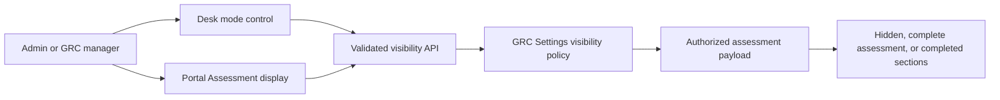

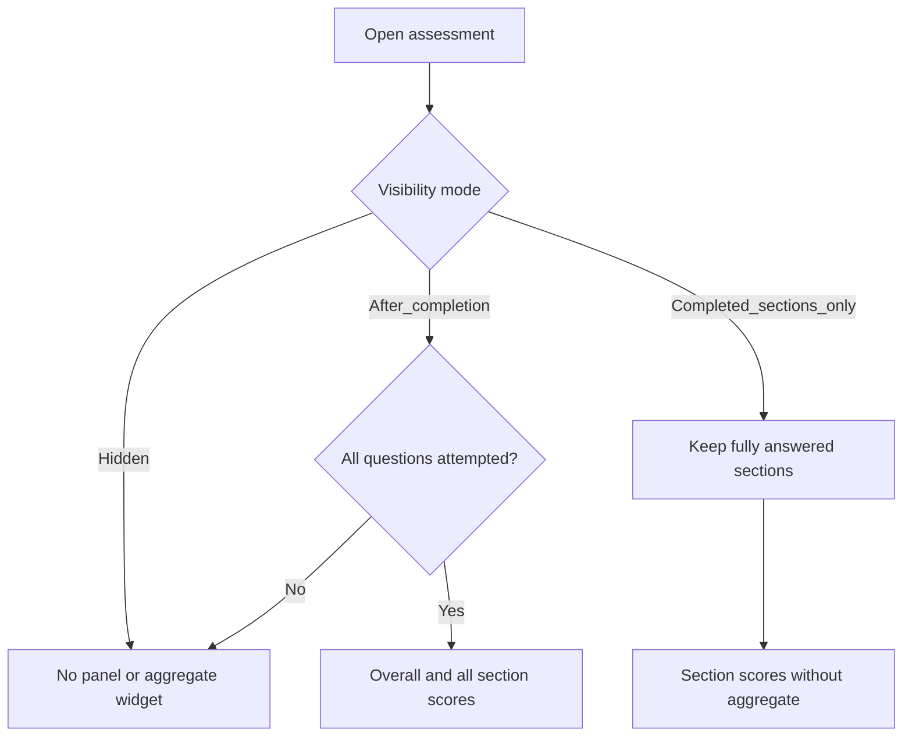

See [v2.11.0 upgrade and validation](RELEASE_v2.11.0.md). Enabled panels open automatically; legacy `expand_maturity` is retained but hidden and superseded.

### Customer assessment focus mode

Editable customer assessments open automatically in a distraction-free, full-window questionnaire. Navigation, reports, maturity panels and activity stay in the background. Progress, questions, save status and section navigation remain available. Staff and read-only assessments retain their usual layout.

The **Normal view** button restores the surrounding application without resetting answers. **Full screen** returns to focus mode. The choice is remembered per user and assessment for the browser tab session. Escape and the browser fullscreen exit also select normal view. Submission and leaving the editor restore the surrounding application.

Native browser fullscreen requires a trusted user gesture: it is requested on the first answer or section-navigation interaction, or the Full screen button. If unsupported or denied, the full-window focus layout remains usable. See [Fullscreen API activation requirements](https://developer.mozilla.org/en-US/docs/Web/API/Element/requestFullscreen). No server setting, DocType or API change is required; existing answer permissions and autosave apply. The presentation is implemented by `useAssessmentFocus` and the assessment editor.

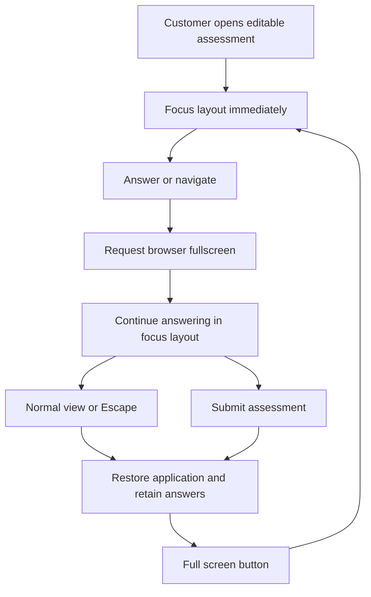

## Active assessment template selection (v2.12.1)

The Start assessment dialog offers only templates with both `is_active=1` and `grc_published=1`, for customers and staff including GRC administrators. An inactive or unpublished default is excluded; the first eligible template becomes the initial choice. If none are available, the selector and submission are disabled and an explanatory message appears. Template management still lists inactive versions for administration. Existing assessments keep their template and snapshot.

`activeAssessmentTemplates` filters creation choices; `new_assessment` continues validating the same policy on the server. No configuration, DocType or API change is required.

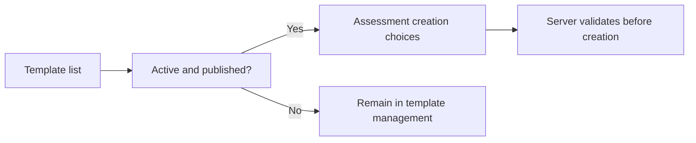

## Questionnaire scrolling and focus controls (v2.13.0)

Questions and options grow with their content instead of shrinking to the viewport. Fullscreen owns a vertical scrollbar; normal view retains document scrolling. Long unbroken text wraps, narrow grids fit the available width, and keyboard-selected options have a visible focus outline. Section navigation brings the new questions into view in normal mode.

Fullscreen customers can independently toggle **Hide section overview** and **Hide progress**, then show either again. The progress toggle covers both counts and the progress bar. The choices stay with the current editor while navigating sections or switching modes; normal view restores the configured overview and progress. Previous/Next and Save remain available when the overview is hidden. Admin visibility restrictions continue to apply. No API, DocType or server setting changes are introduced.

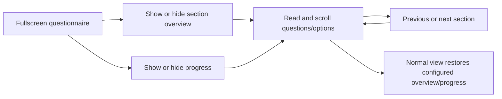
