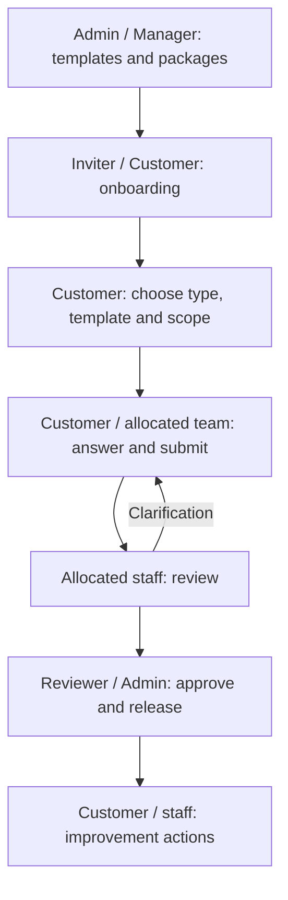

# AlphaX GRC easy role guides

English quick-start guides for the app at v2.16.1, prepared 11 November 2026. Each five-page PDF includes role capabilities, exact menu locations, an end-to-end flowchart, six step-by-step tasks and troubleshooting. Branding uses the app's original AlphaX logo and workspace palette.

| Role | PDF |
| --- | --- |
| Customer | [Customer guide](AlphaX-GRC-Customer-Guide.pdf) |
| Auditor | [Auditor guide](AlphaX-GRC-Auditor-Guide.pdf) |
| Manager | [Manager guide](AlphaX-GRC-Manager-Guide.pdf) |
| Admin | [Admin guide](AlphaX-GRC-Admin-Guide.pdf) |
| Consultant | [Consultant guide](AlphaX-GRC-Consultant-Guide.pdf) |

[Download all five as a ZIP](AlphaX-GRC-Role-Guides.zip).

These are standalone easy guides. Existing bilingual in-app Help/PDFs remain available. Menu labels use English; permissions, ownership locks and assessment team allocations determine which actions a user sees. The staff workspace is shared: Consultant responsibility does not confer Reviewer approval/release rights. Managers manage template availability and packages from Audit packages; the full questionnaire editor remains admin-only.

## Regenerate

Install Python and `reportlab`, then run `python docs/easy-guides/build_guides.py` from the app root. The script uses the checked-in branding asset and creates the five PDFs plus the ZIP in this directory. Update the stated app version/date when revising the content. Do not include private customer data or screenshots.

## Content verification

Checked against `grc/src/App.tsx`, `pages/Dashboard.tsx`, `pages/AuditPackages.tsx`, `pages/Onboarding.tsx`, existing shared guide content, and backend `grc/security.py`, `grc/assessments.py`, `grc/onboarding.py`. All 25 pages were rendered and visually inspected; each PDF was checked for page count and extractable text, and ZIP contents were verified against the source PDFs.

[App README](../../README.md) | [Feature documentation](../introduction.md) | [Changelog](../CHANGELOG.md)
