# GRC developer introduction

Version **3.0.1** sends a Frappe user with no GRC role to Desk at `/app/home`. See [Normal ERP Desk access](#normal-erp-desk-access-v301).

Version **3.0.0** implements the final customer journey with OTP-only access,
explicit department entitlements, selected-scope GRC46, report attachments,
admin-controlled default-off staff2FA and role-specific workflow guidance.
The [v3.0.0 section](#iagrc-customer-and-staff-journey-v300) supersedes historical
customer password/MFA and staff Desk instructions below. Read the
[breaking upgrade notes](RELEASE_v3.0.0.md) before rollout.

Version **2.15.1** sends customer verification emails immediately and reports delivery failures. See [release and upgrade notes](RELEASE_v2.15.1.md).

Version **2.15.0** adds customer assessment-type selection and administrator/manager template classification. See [release notes](RELEASE_v2.15.0.md).

Version **2.14.1** corrects normal signup retries and displays the remaining rate-limit wait. See [release and upgrade notes](RELEASE_v2.14.1.md).

Version **2.14.0** adds audit packages, auditor-owned onboarding and role guidance, with customer oversight, operational approvals and approved website editing. See [release and upgrade notes](RELEASE_v2.14.0.md).

[Questionnaire scrolling and focus controls](#questionnaire-scrolling-and-focus-controls-v2130) · [v2.13.0 release notes](RELEASE_v2.13.0.md)

[Active assessment template selection](#active-assessment-template-selection-v2121) · [v2.12.1 release notes](RELEASE_v2.12.1.md)

[Customer assessment focus mode](#customer-assessment-focus-mode)

Version **2.12.0** adds automatic customer questionnaire focus mode and a persistent Normal view choice. See [release notes](RELEASE_v2.12.0.md).

[README](../README.md) · [Changelog](CHANGELOG.md) · [Development criteria](DEVELOPMENT.md) · [Operations](GRC_OPERATIONS.md)

Version **2.10.0** adds admin/manager-managed color ranges shared by the UI and PDF, with report snapshots. See [release notes](RELEASE_v2.10.0.md). Version **2.9.0** adds screenshot-aligned opening rows, visible section tabs and shared percentage colors with rounded bars. See [release notes](RELEASE_v2.9.0.md). Version **2.8.0** adds reference-colored A4 reports, completion-based customer visibility and editable default-template revisions. See [release notes](RELEASE_v2.8.0.md). Version **2.6.0** adds personal Help/tour visibility and fixes assessment email recipients and active MFA-session invalidation. See [release notes](RELEASE_v2.6.0.md). Version **2.5.0** adds central MFA with Enabled, Disabled and Enforced policies, authenticator/email methods, optional enrollment and platform preservation. See [release notes](RELEASE_v2.5.0.md). Version **2.4.0** adds role and individual MFA policy controls, including app administrators. Version **2.3.0** adds bilingual role guides and page-specific tours. Version **2.2.0** keeps the 2.1.0 maturity bands and adds full-page template administration, response/report policies, optional multi-select scoring and a live customer score. The portal builds on the site-specific GRC extension introduced in 1.6.0 and the imported IA Maturity 1.5.0 app. All application behavior, React source, schema, permissions and migrations live in `ia_maturity`. Production release of the 2.0.0 workflows still follows the gates in [release notes](RELEASE_v2.0.0.md). Scoring and admin UI changes are in the [changelog](CHANGELOG.md).

## Contents

- [Admin controls and assessment guidance](#admin-controls-and-assessment-guidance-v310)
- [Performance with workflow preservation](#performance-with-workflow-preservation)
- [GRC site activation and server migration](#grc-site-activation-and-server-migration)
- [Normal ERP Desk access](#normal-erp-desk-access-v301)
- [IA/GRC customer and staff journey](#iagrc-customer-and-staff-journey-v300)
  - [Department architecture and data](#department-architecture-and-data)
  - [Customer OTP and invited signup](#customer-otp-and-invited-signup)
  - [Selected assessment and report workflow](#selected-assessment-and-report-workflow)
  - [Second audit type approval](#second-audit-type-approval)
  - [Staff security and workflow guidance](#staff-security-and-workflow-guidance)

- [Company profile](#company-profile-v2170)

- [Optional section choices](#optional-section-choices-v2162)

- [Customer assessment dates](#customer-assessment-dates-v2161)

- [Template availability and defaults](#template-availability-and-defaults-v2160)

- [Immediate verification email](#immediate-verification-email-v2151)
- [Assessment type selection](#assessment-type-selection-v2150)

- [Signup verification retry handling](#signup-verification-retry-handling-v2141)
- [Audit packages and confirmed scope](#audit-packages-and-confirmed-scope)
- [Auditor-owned onboarding and tracking](#auditor-owned-onboarding-and-tracking)
- [Customer ownership controls](#customer-ownership-controls)
- [Role guidance for packages and onboarding](#role-guidance-for-packages-and-onboarding)
- [Customer and auditor oversight](#customer-and-auditor-oversight)
- [Configurable report color ranges](#configurable-report-color-ranges-v2100)
- [Percentage colors and questionnaire opening](#percentage-colors-and-questionnaire-opening-v290)
- [Focused assessment controls and A4 reports](#focused-assessment-controls-and-a4-reports-v280)
- [Website content and approvals](#website-content-and-approvals)
- [Personal Help and tour visibility](#personal-help-and-tour-visibility)
- [Central MFA policies](#central-mfa-policies)
- [Bilingual guides and page tours](#bilingual-guides-and-page-tours)
- [Architecture overview](#architecture-overview)
- [DocType model](#doctype-model)
- [Login, MFA and account isolation](#login-mfa-and-account-isolation)
- [Organization onboarding and membership](#organization-onboarding-and-membership)
- [Customer assignments and revocation](#customer-assignments-and-revocation)
- [Dashboards and shared controls](#dashboards-and-shared-controls)
- [Templates and assessment lifecycle](#templates-and-assessment-lifecycle)
- [Template admin dashboard and customer preview](#template-admin-dashboard-and-customer-preview)
- [Comments attachments and report delivery policy](#comments-attachments-and-report-delivery-policy)
- [Suggested maturity scoring](#suggested-maturity-scoring)
- [Multi-select questions and live score](#multi-select-questions-and-live-score)
- [Results and report release](#results-and-report-release)
- [Evidence and improvement actions](#evidence-and-improvement-actions)
- [Profile and password changes](#profile-and-password-changes)
- [Public website and operations](#public-website-and-operations)
- [Public journey, PDF routing and ERP previews](#public-journey-pdf-routing-and-erp-previews)
- [Customer authenticator enrollment](#customer-authenticator-enrollment)
- [Signup policy and email delivery](#signup-policy-and-email-delivery)
- [Report email and PDF access](#report-email-and-pdf-access)
- [Verified signup and admin MFA policies](#verified-signup-and-admin-mfa-policies)
- [Backend identity enforcement](#backend-identity-enforcement)
- [Dedicated signup and organization details](#dedicated-signup-and-organization-details)
- [Registration recovery and resend](#registration-recovery-and-resend)
- [Organization switching and holding companies](#organization-switching-and-holding-companies)
- [Staff Desk and scoped managers](#staff-desk-and-scoped-managers)
- [Customer work prepared by staff](#customer-work-prepared-by-staff)
- [Ownership transfers](#ownership-transfers)
- [Mandatory and optional notifications](#mandatory-and-optional-notifications)
- [Assessment activity timelines](#assessment-activity-timelines)
- [Source and API map](#source-and-api-map)

## Admin controls and assessment guidance v3.1.0

GRC App Admins use Settings to choose the organization profile's yes/no presentation and defaults for new users' page tours and Help. New accounts snapshot those defaults; existing personal preferences are preserved, and each user can change them in their profile. Dropdown is the default presentation and guide controls are enabled by default.

The verification limits panel provides independent email and IP protections for customer OTP requests, plus targeted counter inspection and reset. Both protections default to enabled. Policy changes and reset requests require a reason and are recorded in GRC Activity. Disabling either protection applies site-wide, increases abuse risk, and does not change provider or Frappe authentication controls. Resetting an IP affects all clients sharing it. The `verification_limit_policy`, `set_verification_limit_policy`, `verification_limit_status` and `clear_verification_limits` APIs enforce GRC admin authorization.

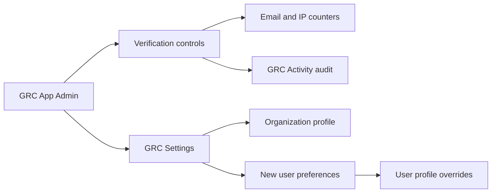

The assessment overview lists unanswered question codes by section. Selecting a code opens its section and focuses the question; indicators update as answers change. N/A remains an answer where offered. The first assessment choice carries through to creation, while organization authorization and invitation constraints remain enforced by the server.

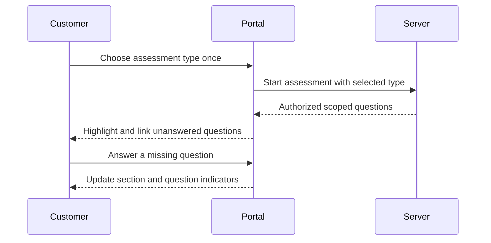

Apply the site migration and build assets for this version; no existing user preferences are rewritten. See [operations](GRC_OPERATIONS.md), [changelog](CHANGELOG.md) and [README](../README.md).

## Performance with workflow preservation

Public/login startup does not download the portal SDK, workspace shell or full
assessment/guide routes before rendering. The small login component is loaded
directly to avoid a measured React Suspense cold-route fallback delay; heavy
workspace screens remain lazy. Language and RTL attributes apply before
the first React paint; preference persistence retains its existing effect. Public approved-copy loading runs
independently of bootstrap; private previews, signup and portal routes retain an
authoritative session gate. One in-flight bootstrap serves focus, timer and
refresh callers. Hidden tabs stop polling; returning tabs refresh immediately,
and visible tabs retain the existing30-second refresh interval. Authentication
changes pause automatic bootstrap, drain older cookie-setting responses and
serialize login/OTP/reset/logout with a fresh scoped session lookup. This prevents
an older Guest response overwriting a newly authenticated Frappe sid cookie;
failed authentication resumes normal refresh and live revocation still redirects.

The public API signatures and response shapes remain unchanged. Bootstrap batches
user preference fields, while repeated entitlement/name reads reuse results only
within an explicit read operation keyed by site and current actor. Results are
copied. Writes, service operations, commits and rollbacks disable reuse; unknown
database write tracking fails closed. No private authorization, dashboard or
bootstrap response is stored across requests. Display-name masking still checks
stored password hashes; identical candidates are verified once per read scope.

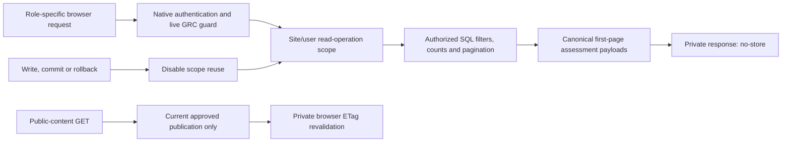

Dashboard counts/filters/search/order/page size retain their previous definitions;
SQL authorization mirrors the current tenant, department, profile, contributor,
holding and results-visibility rules. The first15 assignments still use the
canonical assessment payload, preserving scoring, report capabilities and frozen
history. Dashboard-only activity/action previews materialize at most5 rows.
The activity API retains its complete authorized response and customer-detail
sanitization. No index/schema migration is introduced without query-plan evidence.

Approved-copy responses use `private, no-cache, must-revalidate` with an ETag
computed from the current body; a changed publication immediately changes the
validator. Draft preview and private endpoints never share this cache. Long-lived
immutable caching applies only to fingerprinted static assets in the destination
reverse proxy. Retain the previous asset hashes across deployment so already-open
browsers can fetch lazy route chunks.

See [performance measurement and rollout](PERFORMANCE_OPERATIONS.md) for the
isolated muted fixture, reproducible profiles,50-client30-minute gate and
destination-host checklist. Lab interactions are not field INP; local results do
not imply deployment or real inbox acceptance. See [README](../README.md) and
[changelog](CHANGELOG.md#unreleased).

## GRC site activation and server migration

GRC activation is site-specific configuration, independent of app installation
and the restored database. Operators must set `grc_enabled` to `1` for the intended
site before running `migrate`; `ia_maturity.grc.setup.setup` skips GRC setup when
the setting is absent or false. `ia_maturity.grc.security.enabled` also gates the
GRC page contexts in `www/grc.py` and `www/grc_site.py`.

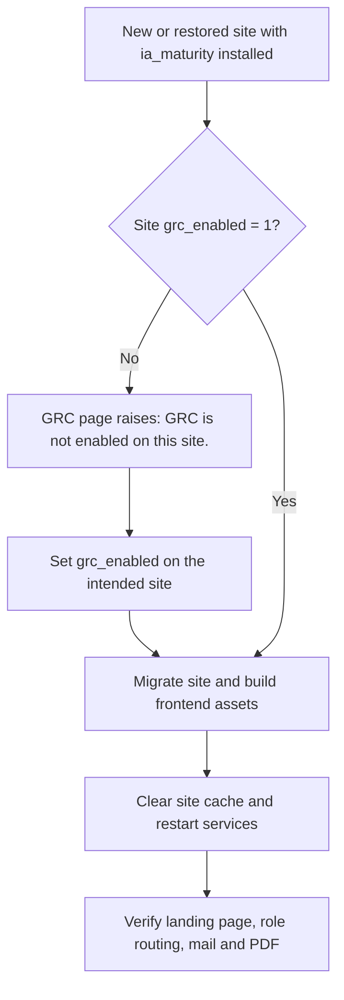

A database-only restore can retain the `grc-site` website home route without
restoring the activation flag from `site_config.json`. Preserve the original
encryption key for encrypted credentials, update the public `host_name` and
database connection settings for the destination, and verify hostname-to-site
routing. If activation still fails after a restart, check that the running web
processes serve the site and bench that were updated. No DocType/API or user-role
change is required to activate the site.

Follow the [README setup checklist](../README.md#grc-site-setup-and-server-migration)
for executable commands and troubleshooting, and the [operations guide](GRC_OPERATIONS.md)
for restoration and service configuration. This documentation update is recorded
in the [changelog](CHANGELOG.md#unreleased); it does not change app behavior.

## Normal ERP Desk access (v3.0.1)

A signed-in user with no GRC role uses the normal Frappe Desk. GRC customer and staff roles still open only their portal. `IA Assessment Respondent` and a leftover account classification do not count as a GRC role. If the account is still a Website User, the first Desk request makes it a System User so `/app/home` is not rejected.

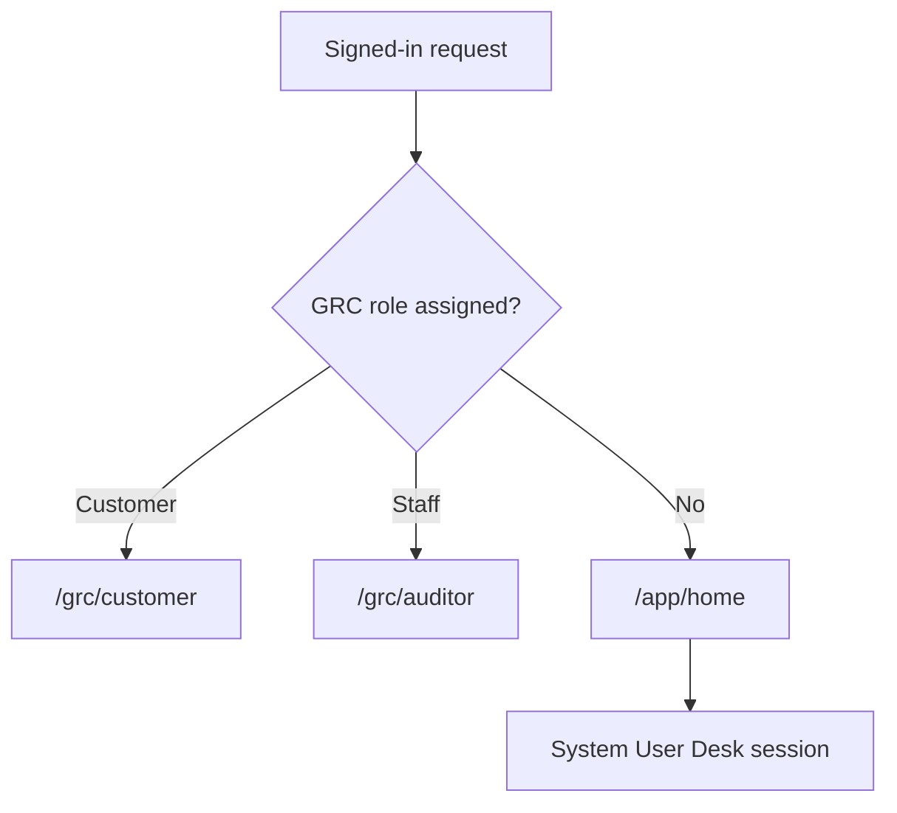

## IA/GRC customer and staff journey (v3.0.0)

These features implement the user-approved local demo journey. Broader combined
Excel/DOCX acceptance remains separately tracked; UI Arabic support does not
certify approved Arabic questionnaire source. Configuration/upgrade instructions
are in [release notes](RELEASE_v3.0.0.md); practical steps are in the
[demo runbook](DEMO_JOURNEY.md). See [README](../README.md) and
[changelog](CHANGELOG.md) for version history.

### Department architecture and data

`departments.py` owns department membership, company grants and additional-audit
requests. The existing `security.py` predicates combine these with customer
membership, assignments, profile/artifact capability and actor identity. React
uses explicit bootstrap/action capabilities; the server rechecks mutations and
private artifacts. A department manager sees granted companies in their managed
department, while official review actions still require the named reviewer.

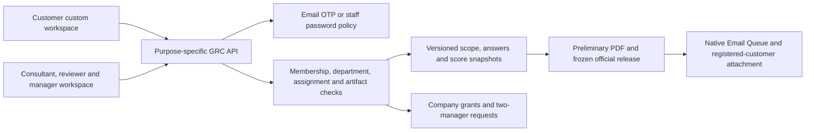

New DocTypes are `GRC Department`, `GRC Department Staff`, `GRC Department Grant`
and `GRC Audit Type Request`. Existing assessment/assignment/activity/report/
follow-up records carry department provenance. Enabled-site setup creates IA/GRC
departments, backfills grants only from historical assessments, and installs the
GRC46 seed. It never infers staff memberships from role names. Companies without
historical assessments need their permitted first audit choice/grant; absence of
a grant does not authorize staff access. Existing assignments do not establish
cross-department permission.

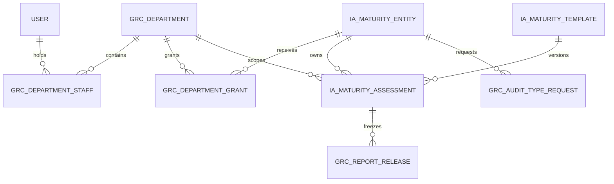

### Customer OTP and invited signup

`auth.request_code` requires full name/company/email/consent for new self-signup,
then sends a short-lived single-use OTP immediately through native mail
transport. Verification creates the account and stamps the consumed-OTP session.
Every returning customer uses another email OTP. Password/reset, old unstamped
sessions and customer API-token authentication cannot bypass this requirement.
Staff and ordinary ERP authentication remain separate.

`onboarding.py` binds invitations to recipient/company/audit type and minimum
sections; the inviting department is identified on the page/email. Invited
customers skip audit choice, cannot change invitation identity and cannot remove
minimum sections. Expired/closed/invalid links explain recovery without disclosing
another department's customer. Optional invitation dialogs can be cancelled;
cancel resets unsent choices. Richer pinned template/reviewer/due-date metadata
remains a broader unfinished source task.

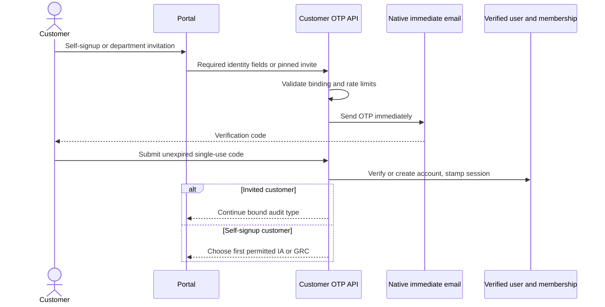

Missing outgoing transport, expired codes and rate limits have actionable error,
resend and retry states. Native SMTP acceptance is not proof of inbox delivery.
The local test sink never replaces product mail delivery on a deployed site.

### Selected assessment and report workflow

`workbook.py` validates the GRC seed with46 questions/184 statements, thirteen
named topics, source hash/cell references and workbook scoring bands. Awareness
has two questions, Governance14, Risk17 and Compliance13. Awareness is mandatory;
at least one of Governance/Risk/Compliance must be selected. IA20 is independent.
The reusable GRC company profile is validated before section/question access.

`scope.py`, `assessments.py` and scoring operate on shown selected sections only;
A/B/C/D score25/50/75/100 and permitted N/A responses are excluded. Submission
requires every shown question to be answered and freezes profile/scoring
snapshots. UI shows missing count/first-question navigation, saves drafts and
provides Save and exit; failed saves keep dirty answers and offer retry.

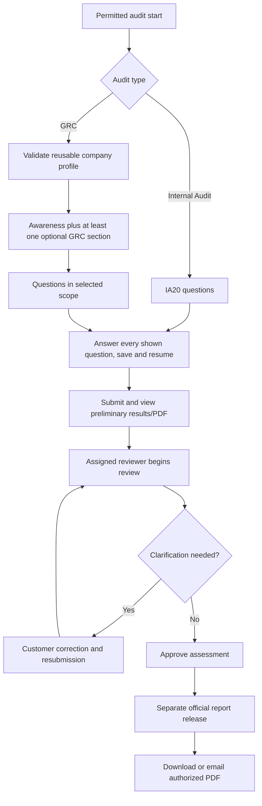

`report_policy.py` and `report_delivery.py` enforce per-action availability and
timing. Immediate preliminary customer results do not auto-release the official
report. Email targets the registered customer and attaches the authorized
matching PDF; report bytes and snapshots remain frozen at release. UI explains
restricted/timing states and the next actor rather than offering dead actions.

### Second audit type approval

An organization-admin customer requests another type using `request_audit_type`.
The source manager approves first, then the target manager accepts; only that
second approval activates the new company grant. `audit_type_requests` returns
explicit decision capability, and `decide_audit_type_request` rechecks the actor,
current stage, requesting customer and organization state under locking.
Invitations to an existing other-department customer use this precheck instead
of silently granting access. General selective-sharing/transfers remain broader
unfinished work.

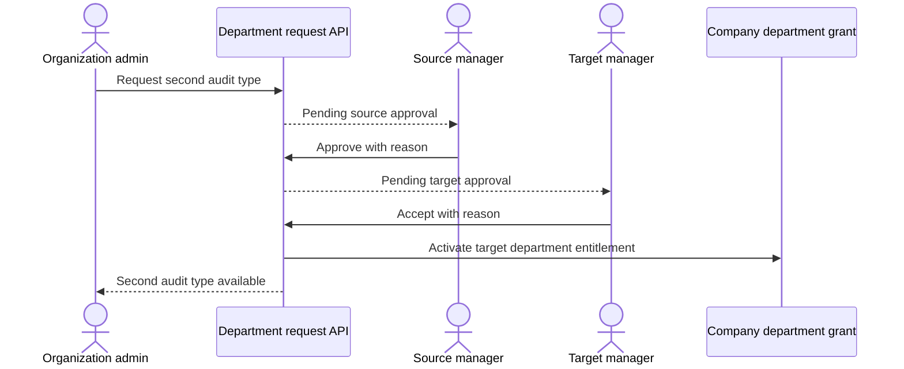

Rejection does not create access. Controls show the current next actor; filtered
or empty request lists explain their state, and optional dialogs can close.

### Staff security and workflow guidance

`account_security.py` and `mfa_policy.py` combine a Disabled default with explicit
username policies, role policies and global settings. Username overrides win;
Required wins among multiple roles; roles override the global default. Existing
explicit/ERP requirements remain preserved. Policy writes require app-admin
password authorization, audit records and affected-session revocation. Optional
staff enrollment follows the effective policy; customers always use email OTP.

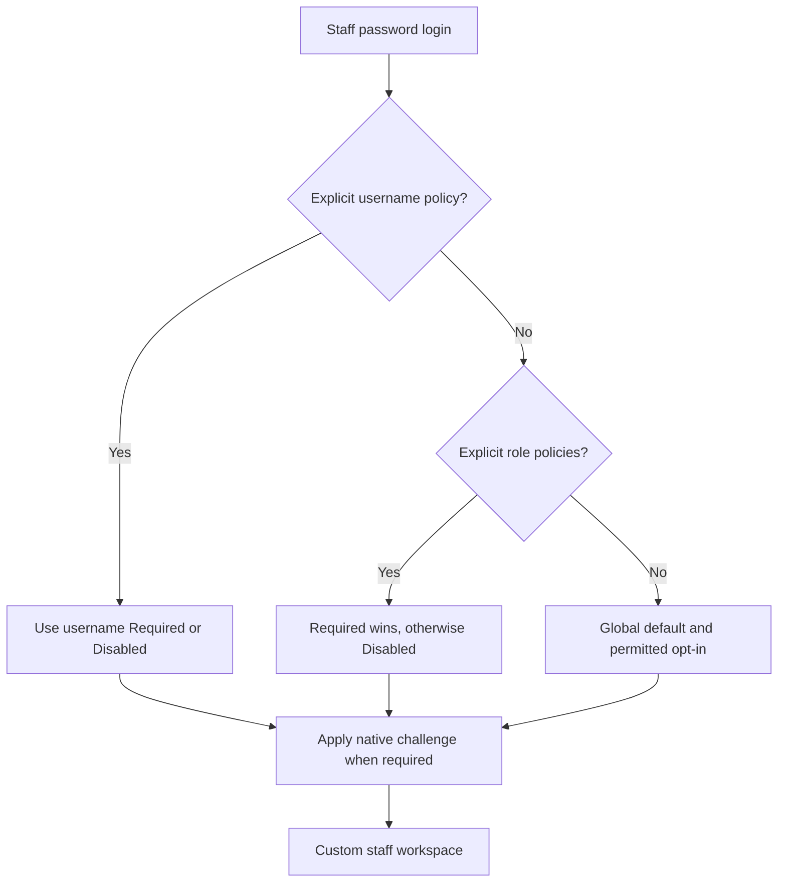

Staff login uses `/grc/auditor`; authenticated `/app/grc-staff` redirects302 with
`no-store`. Optional Getting started and help can be dismissed/reopened. Empty
assignment/filter/template/roster views explain the next action and who can do
it. Managers see granted management scope; consultants and reviewers receive
assignment/capability-aware instructions. First assignment loads eligible
same-department staff, not only existing assignments. Required customer gates
remain mandatory. See [eight-role UX acceptance](UX_ROLE_REVIEW_2026-11-12.md)
for browser, backend and bilingual PDF validation and remaining source limits.

## Immediate verification email (v2.15.1)

`ia_maturity.grc.auth.request_code` uses `frappe.sendmail(delayed=False, now=True)` for eligible customer signup, email-code sign-in and invitation verification. The configured outgoing Email Account and native Email Queue retain transport and audit records, but these codes do not wait for a scheduler flush or worker. The request waits for the SMTP send attempt; SMTP acceptance is not a guarantee of immediate inbox arrival.

The Email Queue document is reloaded because native sending updates its database status without updating the original Python document. Success requires persisted `Sent` status. Invitation binding is saved before native SMTP commits, so an immediately opened link retains its recipient/inviter restrictions. Missing outgoing configuration, SMTP exceptions, muted mail and suspended mail produce a translated delivery error. Native SMTP commits before contacting the provider, so failure cleanup explicitly commits an expired registration and expires unsent email records for that attempt before raising. Users can request a fresh code after the existing cooldown; failed accepted attempts still consume the normal hourly allowance.

Codes remain valid for 15 minutes and single use. Existing validation, neutral ineligible responses, Redis limits, invitation ownership and password/MFA requirements remain. Normal invitations, reminder/report mail and Frappe's password-login MFA delivery are unchanged. There are no new DocTypes, settings or dependencies; the [architecture](#architecture-overview) and [DocType model](#doctype-model) still apply. See [operations](GRC_OPERATIONS.md#verification-email-delivery), [release notes](RELEASE_v2.15.1.md) and [changelog](CHANGELOG.md).

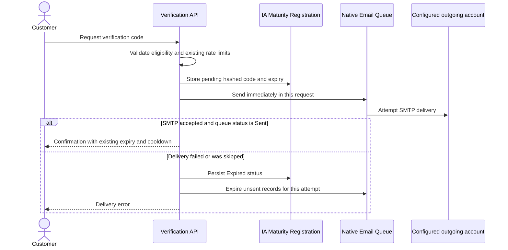

## Assessment type selection (v2.15.0)

Customers who can start assessments choose **Internal Audit** or **Governance, Risk and Compliance** on the dashboard, then continue to a filtered template dropdown. The shared start dialog also requires a choice when opened from other pages. Organization onboarding and approval gates still apply before assessment creation. A type with no active published templates cannot start an assessment.

Administrators and GRC managers open **Audit packages**, select a published questionnaire version, and save its **Assessment type**. `IA Maturity Template.assessment_type` stores the classification. `set_template_type` requires the existing scope-configuration capability, validates the two allowed values, locks the template, checks its modification timestamp and records before/after values in GRC Activity. These permissions do not grant unrelated questionnaire-content administration.

`templates(assessment_type=...)` filters discovery server-side. `start_assessment(..., assessment_type=...)` rejects a mismatched template while preserving membership, assignment and publication checks. Classification is discovery metadata; correcting it does not alter existing questions, assessment snapshots, scores or reports. The optional API argument preserves existing callers. GRC setup idempotently fills missing classifications with Internal Audit; administrators can then map relevant versions to GRC. See the [configuration guide](GRC_ASSESSMENT_TYPES.md) and [release notes](RELEASE_v2.15.0.md).

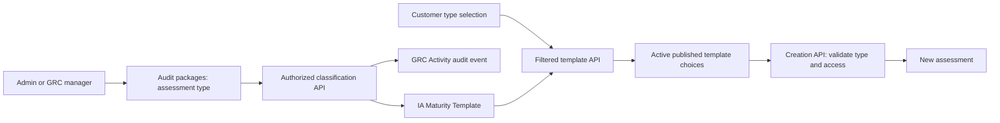

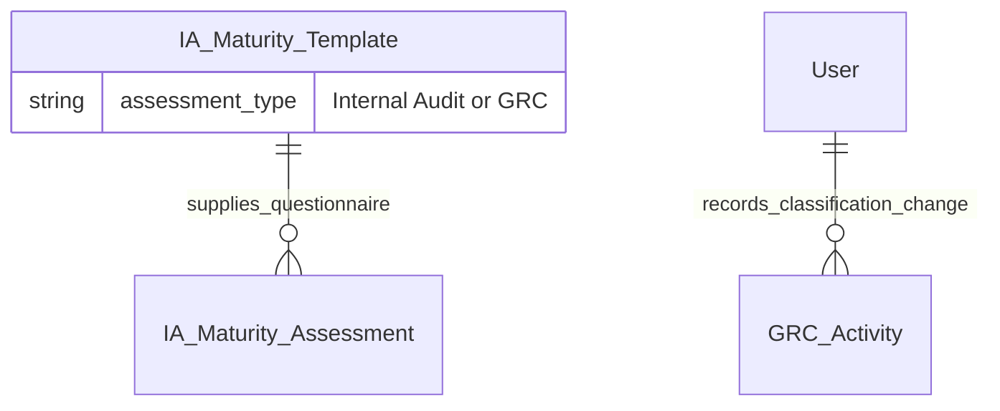

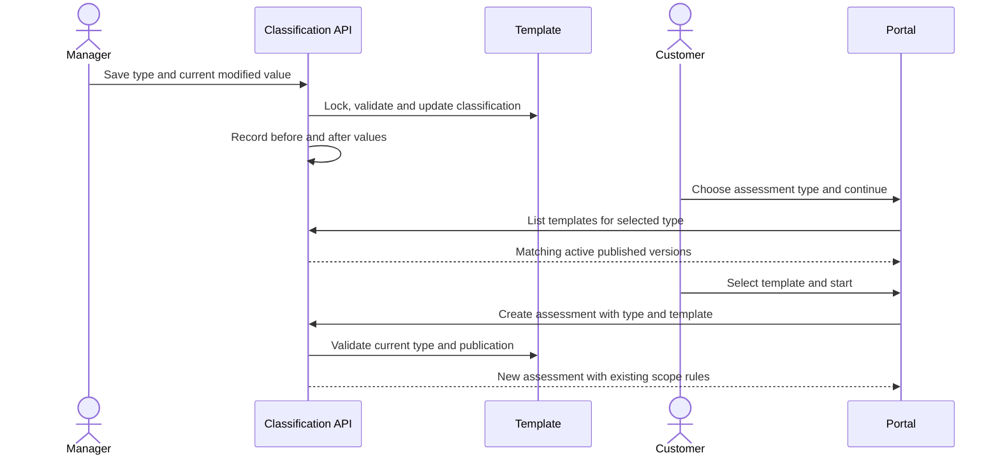

## Signup verification retry handling (v2.14.1)

The guest POST endpoint `ia_maturity.grc.auth.request_code` serves normal customer signup and email-code sign-in, as well as invitation verification. Previously it incremented the hourly email counter before validating signup fields or checking the one-minute cooldown. Repeated form errors and early retries could therefore exhaust five hourly attempts without sending five emails.

The endpoint retains the 30-attempts-per-IP/hour boundary, validates eligible signup input and then uses `code_request_limit` to check/reserve both email limits in one Redis script. Accepted requests consume one hourly slot and start a 60-second cooldown; cooldown rejections consume no additional email slot. Ineligible addresses retain neutral responses and the same email limits. Mail-queue failures still consume an accepted attempt. There are no new DocTypes or settings; `IA Maturity Registration`, the mail queue and existing verification/MFA rules remain unchanged.

The existing site-qualified `request-email` and `request-cooldown` Redis keys are reused. Five accepted requests per email per hour remain the maximum. Existing lockouts keep their original expiry; counters missing expiry receive a bounded lifetime instead of becoming permanent. `rate_limit_exceeded` adds `retry_after_seconds` to the JSON error without returning eligibility or remaining quota. `Login.tsx` uses this duration to disable another request for the same normalized email, show an English/Arabic countdown and prevent concurrent browser submissions. Reloading the page does not reset server counters.

See [operations and targeted diagnosis](GRC_OPERATIONS.md#signup-verification-rate-limits), [release validation](RELEASE_v2.14.1.md) and the [changelog](CHANGELOG.md). The broader [architecture](#architecture-overview) and [DocType model](#doctype-model) are unchanged.

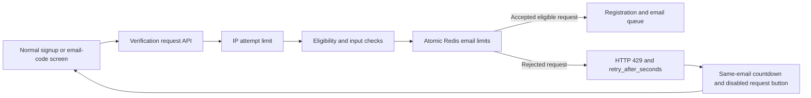

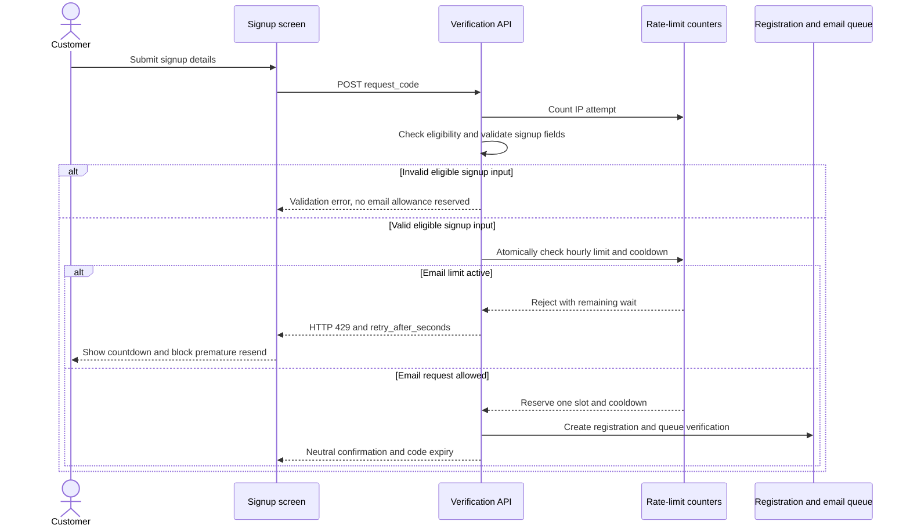

## Audit packages and confirmed scope

Managers and GRC administrators use **Audit packages** to choose a published questionnaire version, mark required sections, define stable package codes with English/Arabic labels and descriptions, map sections, order choices and preview customer coverage. `GRC Audit Scope Configuration` stores draft/published JSON configuration versions. Publication freezes a version; edits create another configuration for future assessments. Package permissions do not grant unrelated questionnaire or scoring-policy administration.

The dedicated `scope_configurations`, `save_scope_configuration` and `publish_scope_configuration` APIs live in `ia_maturity.grc.scope`. New assessments pin the applicable configuration snapshot. Customers confirm selected packages through `confirm_assessment_scope` before answering. The resolver unions required and selected sections, counts overlaps once and rejects unknown packages or empty question coverage. Required-only selection is valid when it includes questions.

`IA Maturity Assessment` stores the configuration snapshot, package selection, resolved sections and confirmation metadata. Question payloads, automatic answers, evidence/submission validation, scoring, gates, findings and actions share this boundary. The frontend uses the filtered payload and normalized included weights; reports identify selected packages and mark omitted sections **Not assessed**. N/A, multi-select, rounding and results visibility keep their existing rules. Legacy assessments and unconfigured questionnaire versions retain all-section behavior; published reports remain frozen.

Only a GRC administrator can call `correct_assessment_scope` on an original unsubmitted draft, with a reason and the current modification value. Locking reads serialize competing writes. Removed answers/evidence remain inactive history and are restored if reselected. The customer must acknowledge corrected scope before continuing. Submitted assessments and clarification revisions cannot change scope; use a new assessment. See [configuration and recovery](GRC_AUDIT_PACKAGES_ONBOARDING.md).

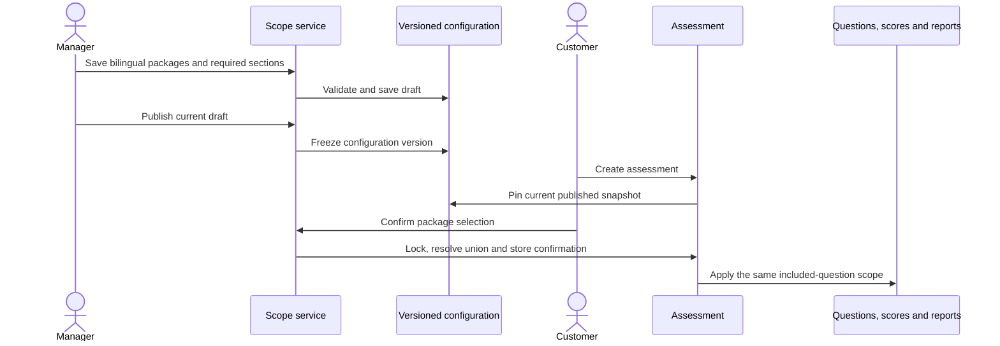

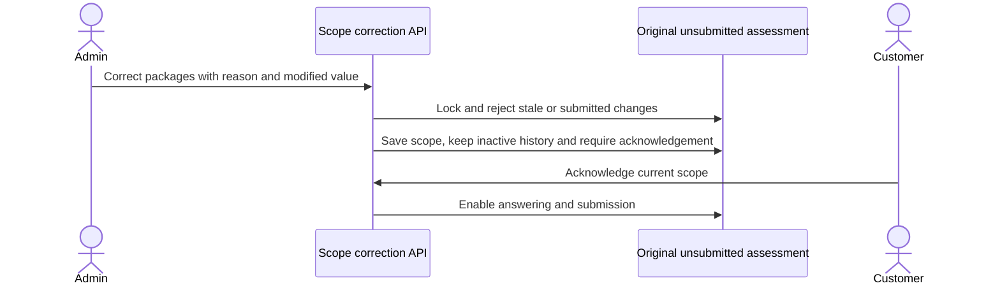

## Auditor-owned onboarding and tracking

**Customer onboarding** is available to auditors before customer assignment. `GRC Onboarding Invitation` stores the verified recipient target, immutable `invited_by`, token hash, expiry, snapshotted auto-lock policy, milestones, events and mail reference. `IA Maturity Registration` and any `GRC Operations Request` carry its server-side reference through verification, MFA and approval. Customers cannot provide an owner identity. Link visits are informational and never consume an invitation or mark progress.

`ia_maturity.grc.onboarding` provides `create_onboarding_invitation`, `onboarding_invitations`, `onboarding_detail` and `onboarding_invitation_action` (remind/resend/revoke). Customer endpoints are `onboarding_link`, `customer_onboarding`, `resume_onboarding` and `complete_onboarding`. Authentication, verified-email matching and request allowlists apply independently of browser storage. The recipient may explicitly resume from another browser. Completion uses a locking read and creates the new entity, membership, Consultant responsibility, owner and lock atomically; repeated completion returns the same result. A unique pending-recipient key prevents competing active invitations.

The tracker exposes milestones, meaningful activity, blocker, next actor and permitted actions without unfinished profile values or secrets. Email **Queued**, **Sent by mail system** and **Failed** states are separate from customer progress. Customer stages become **Needs attention** after 48 hours by default; approval waiting names the approver. Visible pages poll every 30 seconds. Completion and recorded blockers notify the owner in-app; email failures are recorded through the existing queue lifecycle hook.

Invitations expire after seven days. Manual resend/reminder rotates tokens and preserves attribution/progress, subject to 60-second cooldown, recipient rate limit and existing mail safeguards. There are no scheduled onboarding reminders. Wrong-email acceptance, expired/revoked links and disabled inviters cannot activate. Existing organizations are never taken over through name/email matching. An administrator resolves attribution/organization conflicts through the [documented recovery procedure](GRC_AUDIT_PACKAGES_ONBOARDING.md).

```mermaid
sequenceDiagram
    actor Auditor
    participant API as Onboarding service
    participant Invite as Invitation record
    actor Customer
    participant Auth as Verification and MFA
    participant Approval as Operational approval
    participant Records as Entity, membership and ownership
    Auditor->>API: Invite recipient email
    API->>Invite: Record session inviter and policy; hash random token
    API-->>Customer: Queue invitation link
    Customer->>Auth: Sign up or sign in as matching recipient
    Auth->>Invite: Preserve reference and verified milestone
    Customer->>API: Resume and submit organization details
    opt Approval policy enabled
        API->>Approval: Freeze request with original invitation reference
        Approval->>API: Apply final authorized approval
    end
    API->>Invite: Lock and validate recipient, status and inviter
    API->>Records: Atomically create new organization, membership, owner and lock
    API->>Invite: Record completed milestone and customer link
    API-->>Auditor: Owner notification and tracker update
```

## Customer ownership controls

`IA Maturity Entity` holds the owning auditor and visibility lock; `Auditor Customer Assignment` holds active staff responsibilities and named exceptions. `ia_maturity.grc.ownership.staff_allowed` adds the ownership boundary to existing membership/assignment checks. Locked customer staff access is limited to the owner, GRC administrators and explicitly permitted staff. Pending invitations remain private to their original auditor and administrators. Customer membership permissions are preserved.

Administrators use **Onboarding controls** (`ownership_settings`, `save_ownership_settings`) to set the default auto-lock and inactivity threshold. Auto-lock defaults on and is frozen per issued invitation. Existing customers stay unlocked. **Auditor ownership and access** (`customer_ownership`, `set_customer_ownership`) requires a reason and concurrency value to transfer, lock/unlock or change named Consultant/Reviewer/Manager exceptions. Audited before/after values allow operators to explain access changes. Package managers cannot use these account/access controls solely because of their package capability.

Transfers revoke the previous owner's access unless explicitly retained, move active consultant allocations and use existing revocation handling to flag other affected work. Lists, counts, bootstrap, oversight, direct record/file requests, exports and notifications use the current access boundary, so revocation applies on the next request.

```mermaid
sequenceDiagram
    actor Admin
    participant API as Ownership service
    participant Entity as Locked customer record
    participant Work as Staff responsibilities and allocations
    participant Access as Request access boundary
    Admin->>API: Transfer or change exceptions with reason and modified value
    API->>Entity: Lock and reject stale edits
    API->>Work: Revoke old access, apply exceptions and move consultant work
    API->>Entity: Store owner, lock and audit values
    Access->>Entity: Read current ownership on next request
    Access->>Work: Require current responsibility or explicit exception
```

## Role guidance for packages and onboarding

The existing Help system reads shared English/Arabic `grc/src/guide-content.json` and capability-aware role selection. Managers receive their own package-configuration guide and can inspect auditor guidance. Administrators can inspect all four guides; customers and auditors receive their relevant flows. Contextual Help links and new page-tour identifiers cover package configuration, customer selection, invitation creation/tracking and admin ownership controls. Tours target stable `data-tour` attributes, skip unavailable controls and never submit actions. Existing visibility preferences and browser opt-outs remain intact.

Run `cd grc && node scripts/build-guides.mjs` with Node 24, Playwright Chromium and Arabic fonts to regenerate the four checked-in PDF guides. Demonstration images live in `docs/images`; guide source and PDFs describe the same controls. Review English/Arabic layout, page breaks, keyboard navigation and mobile/RTL pages when editing these resources.

## Website content and approvals

Authorized GRC users edit all catalogued public-site English and Arabic text in the Website content workspace. Administrators select existing editor roles and configure ordered approval roles; the workflow and optional submitter-approval rule are frozen when a revision is submitted. `GRC Site Content` stores the published snapshot and role policy, `GRC Site Revision` stores drafts and submitted snapshots, and `GRC Site Event` is the protected audit trail. Public clients receive approved text only; an authenticated preview reads a revision through the authorized API. Legal notices are seeded from existing GRC Settings on migration and subsequently managed through this workflow. See [website content and approvals](GRC_SITE_CONTENT.md) for usage, limitations and deployment.

```mermaid
flowchart LR
    admin["GRC admin"] --> config["Editor roles and approval workflow"]
    editor["Authorized editor"] --> draft["Bilingual draft and preview"]
    config --> draft
    draft --> pending["Frozen revision and workflow"]
    pending --> review["Ordered role approvals"]
    review --> published["Published site content"]
    draft --> audit["Protected audit events"]
    review --> audit
    published --> publicSite["Public English / Arabic site"]
```

```mermaid
sequenceDiagram
    actor Editor
    participant API as Site content API
    participant Revision as Revision and audit
    actor Reviewer
    participant Public as Public site
    Editor->>API: Save bilingual draft
    API->>Revision: Record before and after values
    Editor->>API: Submit draft
    API->>Revision: Freeze approval sequence
    Reviewer->>API: Approve current step
    API->>Revision: Record actor and decision
    API->>Public: Publish only after final approval
```

## Personal Help and tour visibility

Every GRC customer or staff user can open **My profile → Workspace preferences** and independently enable **Show page tour button** and **Show Help button**. Both are visible by default, including existing accounts. Hiding the tour also suppresses first-visit automatic tours. Users can restore either control from their profile; the profile remains available when both buttons are hidden.

User.grc_hide_page_tour and User.grc_hide_help store the account preferences. Migration creates both fields with default 0 and preserves saved values. The profile and bootstrap APIs return workspace_preferences; the POST-only save_workspace_preferences(data) accepts only the two visibility values and always writes the signed-in user. These controls are independent of the administrator's personal-name/profile edit policy. Guest and ERP accounts cannot use this portal endpoint.

Browser tour completion and **Skip automatic tours** remain browser-local. Hiding or showing buttons changes presentation only; direct guide access and authorization rules are unchanged. English and Arabic labels share the same saved preferences.

```mermaid
flowchart LR
    profilePage["My profile / Workspace preferences"] --> preferenceApi["Authenticated self-service API"]
    preferenceApi --> userRecord["User visibility fields"]
    userRecord --> bootstrapData["Profile and session bootstrap"]
    bootstrapData --> helpControl["Help link visibility"]
    bootstrapData --> tourControl["Tour button and automatic tours"]
```

```mermaid
sequenceDiagram
    actor PortalUser
    participant ProfilePage
    participant PreferenceAPI
    participant UserRecord
    participant Workspace
    PortalUser->>ProfilePage: Set tour and Help visibility
    ProfilePage->>PreferenceAPI: POST own preferences
    PreferenceAPI->>PreferenceAPI: Validate portal identity and allowed values
    PreferenceAPI->>UserRecord: Save current user's visibility fields
    PreferenceAPI-->>ProfilePage: Return saved preferences
    ProfilePage->>Workspace: Refresh bootstrap and controls
    PortalUser->>Workspace: Sign in from another browser
    Workspace->>UserRecord: Read saved preferences
    UserRecord-->>Workspace: Keep the same visibility
```

See [v2.6.0 upgrade and validation notes](RELEASE_v2.6.0.md).

## Central MFA policies

Account security gives GRC app administrators one policy for all GRC users: Enabled allows optional enrollment, Disabled removes GRC MFA, and Enforced requires it for every account including app administrators. The centralized verification method is Authenticator app or Email code. Email MFA follows password verification and is separate from customer email registration.

The admin confirms their current password. The backend checks permissions, mail readiness for Email, and conflicting independent roles; it locks current settings, synchronizes authentication roles, records an audit event and revokes affected sessions. Inherited All-role MFA is transferred to a dedicated authentication-only role for non-GRC accounts so the GRC policy can operate without weakening their existing coverage.

Migration preserves legacy role/account settings until the first explicit central save. After adoption, the central policy overrides those settings and their mutation APIs reject changes. Optional enrollment uses a protected User flag. Native Frappe validates credentials and codes; the GRC hook independently verifies short-lived, single-use, account-bound proof for both methods. Changes invalidate pending challenges, and migration preserves the selected method. See the [MFA administration and recovery guide](GRC_MFA_ADMINISTRATION.md).


### Configuration and data

GRC Settings stores mfa_policy, mfa_method, mfa_revision and mfa_preserve_platform. User.grc_mfa_opt_in records optional enrollment. User roles connect native GRC Account MFA enforcement to the selected central policy; GRC Platform MFA preserves the former All requirement for non-GRC accounts. The central endpoints are security_mfa_settings and save_mfa_settings; profile opt-in uses set_optional_mfa or the existing authenticator enrollment endpoints.

~~~mermaid
flowchart LR
    adminUi["Account security"] --> centralApi["Central policy API"]
    centralApi --> grcSettings["GRC Settings"]
    centralApi --> nativeSettings["Native method"]
    centralApi --> accountRoles["User authentication roles"]
    profileUi["Profile enrollment"] --> enrollmentApi["Password-confirmed opt-in"]
    enrollmentApi --> accountRoles
    nativeLogin["Frappe password and MFA"] --> proofGate["Single-use GRC proof"]
    accountRoles --> nativeLogin
    proofGate --> verifiedSession["Verified session"]
~~~

### Admin policy workflow

~~~mermaid
sequenceDiagram
    actor Admin as GRC administrator
    participant Ui as Account security
    participant Api as Central MFA API
    participant Config as GRC and native settings
    participant Accounts as Users and roles
    participant Sessions as Sessions and audit
    Admin->>Ui: Choose policy and method, confirm password
    Ui->>Api: save_mfa_settings
    Api->>Config: Lock and read current settings
    Api->>Api: Verify admin, password, email readiness and conflicts
    Api->>Accounts: Synchronize GRC roles and preserve platform coverage
    Api->>Config: Store policy, method and new revision
    Api->>Sessions: Audit change and revoke affected sessions
    Api-->>Ui: Request sign-in again when affected
~~~

### Email and authenticator sign-in

~~~mermaid
sequenceDiagram
    actor User
    participant Native as Frappe login
    participant Cache as Expiring server challenge
    participant Gate as GRC login hook
    User->>Native: Password
    Native->>Cache: Bind user, password, secret and challenge
    Native-->>User: Authenticator prompt or emailed code
    User->>Native: Challenge and six-digit code
    Native->>Native: Validate native MFA
    Native->>Gate: on_login before session creation
    Gate->>Cache: Lock and verify method, revision, account and code
    Gate->>Cache: Consume challenge once
    Gate-->>Native: Server-validated proof
    Native-->>User: Verified session
~~~

### Optional enrollment

~~~mermaid
flowchart TD
    profile["Profile security"] --> policyCheck{"Central Enabled?"}
    policyCheck -->|No| adminPolicy["Follow Disabled or Enforced"]
    policyCheck -->|Yes| passwordCheck["Confirm current password"]
    passwordCheck --> selectedMethod{"Selected method"}
    selectedMethod -->|Authenticator| scan["Scan QR and confirm TOTP"]
    selectedMethod -->|Email| optIn["Enable email codes"]
    scan --> sync["Lock current policy and synchronize enrollment"]
    optIn --> sync
    sync --> revoke["Audit and revoke sessions"]
    revoke --> loginAgain["Password plus selected factor"]
    passwordCheck --> withdraw["Withdraw optional enrollment"]
    withdraw --> sync
~~~

See [v2.5.0 release and deployment notes](RELEASE_v2.5.0.md) and the [changelog](CHANGELOG.md).

## Bilingual guides and page tours

Signed-in customer and auditor workspaces expose **Help & guides** and **Take page tour** in the header. App administrators can select all four role guides; managers can select manager and auditor guidance. Guidance covers navigation, assessment and review work, packages, onboarding, organization management and first-administrator setup; illustrations use demonstration data, and actual controls depend on role and settings. Read the [current release notes](RELEASE_v2.14.0.md) for deployment and [README](../README.md) for maintenance.

The `Guide.tsx` component reads `guide-content.json` and offers the role-specific PDF assets. `scripts/build-guides.mjs` generates these assets using Playwright Chromium and Arabic fonts; the resulting PDFs are distributed under `ia_maturity/public/guides`. The script and PDFs contain no customer records. Guide delivery itself adds no DocTypes or mutation APIs.

`PageTour.tsx` selects route-specific steps from `pageTourContent.ts`. It waits for page content, highlights controls that are present and omits optional steps for controls that are unavailable. The initial visit to a page automatically starts its tour; users can skip a tour, opt out of future automatic tours, or replay any page manually. Completion and opt-out are stored per account and page in browser local storage, not on the server: a different browser or cleared storage starts fresh. Inaccessible local storage does not prevent manual use, but preferences cannot persist. Tours explain available controls and do not grant access or change records; server authorization remains authoritative.

```mermaid
flowchart LR
    user["Signed-in user"] --> header["Workspace header"]
    header --> guide["Role guide / Guide.tsx"]
    guide --> guideData["Bilingual guide content"]
    guide --> pdf["Role PDF downloads"]
    guideData --> generator["Playwright PDF generator"]
    generator --> pdf
    header --> pageTour["Page tour / PageTour.tsx"]
    pageTour --> steps["Bilingual route steps"]
    pageTour --> browserStorage["Per-account browser preference"]
```

```mermaid
sequenceDiagram
    actor User
    participant Page as Workspace page
    participant Tour as Page tour
    participant Storage as Browser storage
    User->>Page: Open a page after sign-in
    Page->>Tour: Page content becomes available
    Tour->>Storage: Check account and page preference
    alt First visit and automatic tours enabled
        Tour-->>User: Show available steps and examples
        User->>Tour: Next, previous, skip or finish
        Tour->>Storage: Remember page or automatic opt-out
    else Already seen or opted out
        Tour-->>User: Leave page unobstructed
    end
    User->>Tour: Select Take page tour
    Tour-->>User: Replay page-specific steps
```

## Architecture overview

`grc_enabled=1` activates the GRC behavior on a designated Frappe site. Doppio was used to scaffold React; it is not a runtime dependency. The frontend uses TypeScript, Vite, Tailwind, React Router, Frappe React SDK and Radix Select. Build assets and website entry points are generated during deployment.

```mermaid
flowchart TB
    visitor["Browser: EN or AR / RTL"] --> react["React login, customer and auditor workspaces"]
    visitor --> publicPages["Public pages"]
    react --> sdk["Frappe React SDK / purpose-specific APIs"]
    staffDesk["Restricted staff Desk page"] --> sdk
    publicPages --> publicApi["Public metadata and consultation APIs"]
    sdk --> auth["Frappe authentication and GRC request boundary"]
    auth --> services["GRC services: membership, ownership, assignment and action checks"]
    publicApi --> services
    services --> records["Frappe DocTypes and immutable snapshots"]
    services --> scope["Shared confirmed-scope resolver"]
    scope --> outputs["Questions, progress, scores, findings and reports"]
    services --> onboarding["Invitation milestones and atomic activation"]
    services --> approvals["Frozen operations and website approval workflows"]
    onboarding --> records
    approvals --> records
    services --> privateFiles["Private evidence and frozen report PDFs"]
    services --> mail["Tracked notices / Frappe Email Queue"]
    scheduler["Frappe daily scheduler"] --> mail
    hooks["Site-gated hooks and setup migrations"] --> auth
    hooks --> records
    erp["Separate normal ERP account"] --> desk["Existing ERP destination and permissions"]
```

Route guards only determine presentation. Server request restrictions, scoped services, document permissions and file ownership checks are the authorization boundary. Customers cannot use Desk. GRC staff can open only the restricted /app/grc-staff Desk page. Generic resource APIs, API v2 and unrelated ERP/Desk methods remain denied, including with API tokens or accidental ERP roles. Administrators who operate Frappe infrastructure use separate platform accounts.

## DocType model

Names below replace spaces with underscores for diagram readability. Existing `IA Maturity Entity` is the customer organization. The assignment holds the current assessment in a correction chain; earlier submitted assessments remain linked to that assignment.

```mermaid
erDiagram
    User ||--o{ GRC_Organization_Membership : joins
    IA_Maturity_Entity ||--o{ GRC_Organization_Membership : has
    IA_Maturity_Entity o|--o{ IA_Maturity_Entity : parent_of
    IA_Maturity_Entity ||--o{ GRC_Organization_Unit : contains
    IA_Maturity_Entity ||--o{ GRC_Invitation : invites
    User ||--o{ Auditor_Customer_Assignment : receives
    IA_Maturity_Entity ||--o{ Auditor_Customer_Assignment : authorizes
    IA_Maturity_Entity ||--o{ GRC_Assessment_Assignment : schedules
    GRC_Assessment_Assignment ||--o{ IA_Maturity_Assessment : tracks_versions
    IA_Maturity_Template ||--o{ IA_Maturity_Assessment : snapshots
    IA_Maturity_Assessment ||--o{ IA_Maturity_Action : generates
    IA_Maturity_Assessment ||--o| GRC_Report_Release : freezes
    IA_Maturity_Entity ||--o{ GRC_Follow_Up : tracks
    IA_Maturity_Entity ||--o{ GRC_Activity : records
    IA_Maturity_Entity ||--o{ GRC_Reminder_Delivery : notifies
    IA_Maturity_Template ||--o{ GRC_Audit_Scope_Configuration : versions_scope
    GRC_Audit_Scope_Configuration o|--o{ IA_Maturity_Assessment : pins_snapshot
    User ||--o{ GRC_Onboarding_Invitation : originally_invites
    GRC_Onboarding_Invitation o|--o| IA_Maturity_Entity : creates_and_locks
    GRC_Onboarding_Invitation o|--o{ IA_Maturity_Registration : carries_attribution
    User o|--o{ IA_Maturity_Entity : owns
    GRC_Operations_Policy ||--o{ GRC_Operations_Request : snapshots_workflow
    GRC_Onboarding_Invitation o|--o{ GRC_Operations_Request : awaits_approval
    GRC_Site_Content ||--o{ GRC_Site_Revision : publishes
    GRC_Site_Revision ||--o{ GRC_Site_Event : audits
```

Additional records are `GRC Settings` (singleton), `GRC Consultation Request`, existing `IA Maturity Registration` (verification), `IA Audit Issue` (Q13), and private `File` attachments. Setup creates protected User classification and notification fields. Published templates and assessments store JSON policy snapshots.

## Login, MFA and account isolation

One branded `/login` serves all accounts. The built-in Administrator is a platform/ERP identity, even though Frappe grants it every effective role; those synthetic roles must never classify it as GRC staff. From v1.7.2, account classification controls bootstrap and home routing independently of administrative maintenance permissions. Customer accounts enter `/grc/customer`; auditors, reviewers and GRC app admins enter `/grc/auditor`; normal ERP accounts retain their normal destination. Administration appears only for GRC app admins.

Password authentication uses Frappe. Since v1.7.1, its identifier field accepts email or username (including Administrator); login forms submit validation to the backend. Native Frappe validates credentials and OTP, and the GRC login hook independently verifies and consumes the challenge before a session can be created. GRC staff require MFA by default until an administrator adopts the central policy. Thereafter Enabled, Disabled or Enforced applies to every GRC user. The selected method is an authenticator or an emailed verification code after the password. Customer email access cannot authenticate staff or ERP accounts. Local demo MFA uses a guarded helper described in [operations](GRC_OPERATIONS.md); it is not a production enrollment mechanism.

```mermaid
flowchart TD
    login["Shared React login"] --> mode{"Authentication method"}
    mode -->|Password| frappeAuth["Frappe password verification"]
    frappeAuth --> staff{"GRC staff account?"}
    staff -->|MFA required by account policy| mfa["Verify authenticator code and temporary challenge"]
    mfa --> auditor["Auditor workspace; admin screens when authorized"]
    staff -->|No| kind{"Customer or normal ERP?"}
    kind -->|Customer| customer["Customer workspace"]
    kind -->|ERP| erpHome["/app/home"]
    mode -->|Customer email| eligible["Check customer eligibility and rate limits"]
    eligible --> verify["Consume single-use code or link"]
    verify --> customer
```

Verification expires after 15 minutes; five incorrect attempts block that pending verification. A new code expires earlier pending requests. GRC recovery reuses native reset proof and password policy, revokes existing sessions and returns to login without creating a session. Account classification is protected, persists through role changes, and never grants dual ERP/GRC access.

## Organization onboarding and membership

A new customer verifies email before creating an organization. Existing organizations are joined by email-bound invitations, not a public selector. `Organization Admin` manages its profile, departments/branches and memberships. Contributors access assigned work; viewers have the read scope permitted by membership.

```mermaid
flowchart TD
    verified["Verified customer account"] --> choice{"Existing invitation?"}
    choice -->|Yes| validateInvite["Check email, expiry and single-use token"]
    validateInvite --> membership["Activate organization membership"]
    choice -->|No organization yet| createOrg["Create organization and first admin membership"]
    membership --> workspace["Organization workspace"]
    createOrg --> workspace
    workspace --> admin["Organization admin manages units and invitations"]
```

Key services: `organizations.save_organization`, `invite_member`, `accept_invitation`, `save_unit`, `update_membership`. Invitations expire after seven days. The final active organization administrator cannot be removed. A customer can create multiple organizations; joining an existing organization still requires an invitation. Each membership has its own role.

## Customer assignments and revocation

GRC app admins manage all customer assignments. An organization Manager can allocate Consultant/Reviewer responsibility only within their own active Manager assignments; only app admins assign Manager responsibility. Multiple staff can have Manager, Consultant or Reviewer responsibility for one customer. Assessment-level consultant/reviewer allocation is a second prerequisite for review actions, never a way to gain customer access.

```mermaid
sequenceDiagram
    participant Admin
    participant API as GRC services
    participant DB as Assignment records
    participant Auditor
    Admin->>API: Assign customer and responsibility
    API->>API: Require app-admin or scoped Manager permission
    API->>DB: Save active customer assignment
    Admin->>API: Allocate assessment team
    API->>DB: Verify active customer responsibility
    Auditor->>API: Read queue or act on assessment
    API->>DB: Recheck current access and task responsibility
    API-->>Auditor: Authorized records or permission error
    Admin->>API: Revoke customer assignment
    API->>DB: Clear affected task allocation and mark reassignment
    API->>API: Invalidate cache and expire affected queued notices
    Auditor->>API: Next read or private download
    API-->>Auditor: Deny access when no active assignment remains
```

Assignments are unique by organization, auditor and responsibility. An auditor with no assignments has an empty queue. Lists, counts, searches and downloads use the same tenant scope. Frontend bootstrap polls an access fingerprint every 30 seconds and reloads on changes; the server checks each request immediately. Information already viewed or downloaded cannot be recalled. Assignment changes and membership changes are recorded in `GRC Activity`.

## Dashboards and shared controls

Customer dashboards emphasize next actions, assessment progress, permitted results and overdue improvement work. Auditor dashboards emphasize assigned customers, review queues, due dates and follow-ups. Both use the same branded shell, mobile navigation and English/Arabic translations.

```mermaid
flowchart LR
    card["Click dashboard summary card"] --> destination{"Card type"}
    destination -->|Assigned customers| customers["Single customer detail or permitted customer list"]
    destination -->|Assessment metric| query["Assessment route with group query parameter"]
    query --> scope["Server scopes records before filtering"]
    scope --> table["Paginated results; URL survives refresh and navigation"]
```

| Card | Destination/filter |
|---|---|
| Assigned customers | Direct customer detail for one result; list for multiple |
| In progress | Draft and In Progress |
| Awaiting review | Submitted, Resubmitted and Under Review |
| Overdue | The same due-date predicate as the dashboard count |
| Reports released | Report Released |

Selecting an individual status replaces the grouped filter. Shared `Select.tsx` supplies styled popups, keyboard navigation, typeahead, RTL, scrolling, focus return and native form serialization/required validation. Escape closes a dropdown before its containing dialog. Use this component for new portal dropdowns.

## Templates and assessment lifecycle

Admins clone/edit drafts and publish immutable questionnaire versions. Publishing freezes scoring defaults; assessments retain their own questionnaire, section and scoring snapshots. Changing defaults affects future published versions.

```mermaid
flowchart LR
    templateDraft["Template draft or clone"] --> published["Publish immutable version"]
    published --> draft["Draft assessment with snapshots"]
    draft --> progress["In Progress"]
    progress --> submitted["Submitted"]
    submitted --> review["Under Review"]
    review --> clarification["Clarification Required"]
    clarification --> amendment["Amended draft; retain previous submission"]
    amendment --> resubmitted["Resubmitted"]
    resubmitted --> review
    review --> approved["Approved"]
    approved --> release["Report Released"]
```

`api.save_assessment` uses a modified timestamp to reject stale edits. React autosaves answers and flushes pending edits before internal navigation. Row locks protect transitions. Reviewers cannot rewrite submitted answers; clarification creates an amended assessment. The current workflow state belongs to `GRC Assessment Assignment`, alongside respondent, consultant, reviewer and due dates.

Provisional scoring preserves the workbook's Q1 cap, Q20 N/A, calculated Q13 with manual fallback, and equal weighting. Q13 uses the configured issue register/lookback/minimum sample (initially 24 months and five closed issues). Assessment-owner review against the reference workbook remains required.

## Template admin dashboard and customer preview

GRC App Admins manage questionnaires on dedicated routes instead of a modal: `/grc/auditor/admin/templates` (dashboard), `/grc/auditor/admin/templates/new`, `/grc/auditor/admin/templates/:id` (full-page editor) and `/grc/auditor/admin/templates/:id/preview`. Published versions remain immutable; clone to a draft to edit. The editor exposes sections, questions, option text, A–D points from settings, selection mode, multi-score method, gating and comment/attachment overrides. Preview uses the customer assessment chrome and `liveScore.ts` against local answers only — it does not create an assessment.

```mermaid
flowchart LR
    dash["Templates dashboard"] --> create["Create draft"]
    dash --> openEdit["Open draft editor"]
    dash --> preview["Customer preview"]
    dash --> clone["Clone published to draft"]
    openEdit --> save["Save sections and questions"]
    save --> publish["Publish immutable version"]
    preview --> live["Simulate answers and live percent"]
```

Sources: `grc/src/pages/Templates.tsx`, `TemplateFields.tsx`, `templates.css`, `grc/administration.py`.

## Comments attachments and report delivery policy

Comments and attachments are controlled separately. Defaults live on the template; sections and questions may Inherit, Enabled or Disabled. Resolution is question → section → template. Assessment answer rows store the resolved flags at load so in-flight work keeps a stable snapshot. The customer form hides comment and evidence UI when disabled; save APIs reject forbidden values.

Report delivery is configured on `GRC Settings`: allow PDF download, allow email, and timing **After Audit** (default: Report Released only) or **Before Audit** (from Submitted; preliminary PDF until release). Staff bypass customer toggles but still need an eligible workflow state. Enforcement is in `report_policy.py` for `download_report` and `email_report`.

```mermaid
flowchart TD
    qFlag["Question allow_comment / allow_attachment"] -->|empty| sFlag["Section override"]
    sFlag -->|empty| tFlag["Template defaults"]
    qFlag -->|set| resolved["Resolved flags on answer row"]
    sFlag -->|set| resolved
    tFlag --> resolved
    resolved --> ui["Show or hide comment and evidence"]
    settings["GRC Settings report toggles"] --> timing{"After Audit or Before Audit"}
    timing -->|After| released["Report Released"]
    timing -->|Before| submitted["Submitted and later"]
    released --> api["download_report / email_report"]
    submitted --> api
```

Migrate patch `v2_2.grc_admin_response_and_report_policy` backfills defaults that preserve previous behavior (comments, attachments, download and email on; After Audit).

## Suggested maturity scoring

Version 2.1.0 replaces the previous default bands (Critical 0–34, Low 35–54, Medium 55–74, High 75–89, Leading 90–100). Answer points stay A=25, B=50, C=75 and D=100. A section score is points divided by applicable questions times 100. The overall score is total points divided by the total maximum, which is 2,000 when all 20 questions apply. The level is the highest band whose minimum is less than or equal to that percent. The executive summary uses that level's suggested conclusion, in English or Arabic.

```mermaid
flowchart TD
    answers["Answers: A=25, B=50, C=75, D=100"] --> sectionPct["Section percent = points / (questions x 100)"]
    sectionPct --> overallPct["Overall percent = total points / 2,000"]
    overallPct --> band{"Highest band at or below the score"}
    band -->|"0 to 29"| critical["Critical"]
    band -->|"30 to 49"| low["Low"]
    band -->|"50 to 69"| medium["Medium"]
    band -->|"70 to 84"| high["High"]
    band -->|"85 to 100"| leading["Leading"]
    critical --> narrative["Executive summary uses that level's conclusion"]
    low --> narrative
    medium --> narrative
    high --> narrative
    leading --> narrative
```

A score of 73.8% (1,475 of 2,000) is High. Decimal scores use the next threshold: 29.9 is Critical, 30 is Low, 84.9 is High and 85 is Leading. N/A answers stay out of the denominator, and a gating answer can still cap the overall level.

```mermaid
flowchart LR
    settings["IA Maturity Settings bands"] --> publish["Publish questionnaire version"]
    publish --> snapshot["Assessment scoring snapshot"]
    snapshot --> report["Score and conclusion"]
    release["Released GRC report"] --> frozen["Frozen report stays on its original bands"]
    custom["Custom bands"] --> kept["Migrate leaves custom bands unchanged"]
    legacy["Previous default bands"] --> patch["v2.1 patch rewrites defaults and open assessments"]
```

Publishing still freezes the scoring policy into new assessments. The migrate patch updates settings and published policies that still use the previous default thresholds, then relabels assessments that were not already released. Released report snapshots and administrator-defined bands are not rewritten. Source: `scoring.py`, `report_data.py` and `patches/v2_1/suggested_scoring_bands.py`.

## Multi-select questions and live score

The published 20-question workbook remains single A/B/C/D. Admins may set a question to **Multi** for custom templates. Selected letters are stored as a comma-separated `selected_option` (for example `A,C`). Per-question `multi_score_method` chooses Highest (default), Average or Sum (capped at max points). N/A stays exclusive and leaves the denominator; unanswered letters still count as zero in the denominator. Findings and gating use the worst (lowest) letter among selections. Patch `v2_3.multi_select_questions` backfills Single/Highest.

Editable customer assessments show a **Current score** beside answer progress. The client mirrors `scoring.py` using the assessment’s pinned points, bands, weights and gating so the percentage updates as soon as an answer changes. Released assessments keep the locked report score and hide the live figure.

```mermaid
sequenceDiagram
    participant Admin
    participant Template
    participant Customer
    participant Score as scoring.py / liveScore
    Admin->>Template: Set Multi and score method on a question
    Admin->>Template: Publish version
    Customer->>Score: Select one or more options
    Score->>Score: Highest Average or Sum capped
    Score-->>Customer: Live overall percent and band
    Customer->>Score: Submit assessment
    Score-->>Customer: Server score matches live rules
```

Sources: `scoring.py`, `grc/src/liveScore.ts`, `Assessment.tsx`, `patches/v2_3/multi_select_questions.py`.

## Results and report release

In Administration → Settings, choose one audited policy for unreleased customer results:

- **Preliminary scorecard** (default): show labeled submitted self-assessment results; withhold the final PDF until release.
- **Status only**: show status and required workflow actions; withhold unreleased scores, scorecards, score-derived findings/actions and reports.

```mermaid
sequenceDiagram
    participant Customer
    participant API as GRC services
    participant Reviewer
    participant Release as Private release record
    Customer->>API: Request assessment results
    API->>API: Check current access and live visibility policy
    API-->>Customer: Preliminary scorecard or status only
    Reviewer->>API: Release approved assessment
    API->>API: Check reviewer allocation or app-admin permission
    API->>Release: Freeze report context, reference date, PDF and SHA-256
    Customer->>API: Download released report
    API->>API: Recheck tenant access and file integrity
    API-->>Customer: Authorized frozen PDF
```

`GRC Report Release` preserves the release artifact; later scoring, template and visibility changes do not rewrite it. WeasyPrint embeds Arabic fonts and permits only embedded resources. Workflow emails contain status and links, never scores or report attachments. Live cross-customer benchmarking is suppressed in GRC customer reports; a future benchmark needs an approved versioned reference dataset.

## Evidence and improvement actions

Evidence uploads require authorized assessment/action ownership, approved file types and a maximum size of 10 MB. Files are private; knowing a file URL does not grant access. Do not use generic upload or public-file APIs in GRC workflows.

```mermaid
flowchart LR
    submit["Submit assessment"] --> action["Create improvement action with owner and deadline"]
    action --> work["Assigned owner records progress and private evidence"]
    work --> pending["Pending Verification"]
    pending --> reviewer["Authorized reviewer verifies closure"]
    reviewer --> completed["Completed"]
```

Key APIs: `api.upload_evidence`, `actions`, `update_action`. A contributor can update an assigned action without gaining access to another respondent's full assessment. Revocation also blocks private downloads on subsequent requests.

## Profile and password changes

The sidebar avatar/name opens `/grc/customer/profile` or `/grc/auditor/profile`. Admins select self-editable fields in Administration → Settings → Profile editing permissions.

Supported fields: first, middle and last name; mobile number; phone; preferred language; time zone. The default permits all seven. An empty selection locks all seven. Email, roles, classification and organization assignments are never self-editable.

```mermaid
sequenceDiagram
    participant Admin
    participant User
    participant API as Profile API
    participant Policy as GRC Settings
    Admin->>Policy: Select allowed profile fields
    User->>API: Save own profile
    API->>Policy: Read current allowed fields
    API->>API: Reject disallowed fields and validate values
    API-->>User: Updated profile or permission error
    User->>API: Current password, new password and confirmation
    API->>API: Frappe verification and password policy
    API->>API: Audit event without secrets and sign out sessions
    API-->>User: Return to login; apply the current MFA policy
```

`profile.save_profile` always operates on the session user and rechecks the policy. Names cannot contain control characters; values are capped at 140 characters, language is EN/AR and time zones must be valid. Password changes require at least ten characters plus Frappe's configured policy. Password values are never audited.

## Public website and operations

Public pages cover services, assessment catalogue, frameworks/sectors, About, Contact, Resources, FAQs, Privacy and Terms. Consultation submissions are rate-limited and tracked in `GRC Consultation Request`; admins mark them New, Contacted or Closed. Draft legal/framework content must be reviewed before production.

```mermaid
flowchart TD
    visitor["Public visitor"] --> consultation["Submit consultation request"]
    consultation --> adminInbox["Admin consultation queue"]
    adminInbox --> contact["Record Contacted or Closed"]
    workflow["Assessment transition or daily reminder schedule"] --> access["Check recipient access and workflow-email preference"]
    access --> delivery["Idempotent GRC Reminder Delivery"]
    delivery --> queue["Frappe Email Queue"]
    queue --> retry["Transport delivery and retry"]
    retry --> history["Admin delivery history"]
```

`GRC Follow Up` records customer follow-up notes, assignees and deadlines. Reminder interval/default due days are configured in GRC Settings. Customers and staff can opt out of workflow notices; authentication emails remain required. The local site mutes email and disables the scheduler, so production transport and enrollment delivery remain acceptance tasks.

## Registration recovery and resend

Registration exposes Already registered? Sign in, password recovery and a separate staff link. auth.request_code returns neutral guidance and the same timing metadata for eligible/ineligible addresses; staff never receive customer codes. Eligible requests use IA Maturity Registration and standard Email Queue.

~~~mermaid
flowchart TD
    registration["Registration or email sign-in"] --> cooldown["Cooldown and rate limits"]
    cooldown --> eligibility{"Eligible customer flow?"}
    eligibility -->|Yes| pending["Pending verification and immediate SMTP send"]
    eligibility -->|No| neutral["Neutral sign-in and recovery guidance"]
    pending --> neutral
    neutral --> choice{"Customer action"}
    choice --> verify["Verify single-use code or link"]
    choice --> resend["Resend after 60 seconds"]
    choice --> recovery["Native password recovery"]
    resend --> cooldown
~~~

Codes expire after 15 minutes. Resending supersedes previous pending codes; five incorrect attempts block that verification. The UI displays cooldown/expiry and delivery failures. From v2.15.1, success requires SMTP acceptance and persisted `Sent` status; provider delivery/spam filtering still determine inbox arrival. See [immediate verification delivery](#immediate-verification-email-v2151).

## Organization switching and holding companies

IA Maturity Entity.parent_organization represents an optional parent. GRC App Admin configures the hierarchy; validation rejects cycles and locks parent reads. The portal switcher remembers the active organization per account. Lists, records and private downloads still recheck current server permissions.

~~~mermaid
flowchart TD
    request["Assessment request"] --> direct{"Active direct membership?"}
    direct -->|Yes| role["Apply organization-specific role"]
    direct -->|No| parent{"Admin membership in an ancestor?"}
    parent -->|Yes| inherited["Read descendant assessments"]
    parent -->|No| denied["Deny access"]
    role --> read["Authorized reads"]
    role --> edit{"Direct admin or owner contributor?"}
    edit -->|Yes| draft["Edit current draft"]
    edit -->|No| read
    inherited --> readOnly["No inherited edit permission"]
~~~

Organization Admin and Viewer read organization assessments; Contributor access follows owned assessments or assigned actions. Holding administrators inherit descendant reads through multiple levels. Direct subsidiary membership controls writes independently. Revocation applies on the next request. Matching organization names or email domains never grant membership.

Key APIs: organizations, organization_detail, save_organization, update_membership and scoped assessment/action/file services. Parent access does not expose subsidiary membership management, invitations or internal staff notes.

## Staff Desk and scoped managers

GRC Manager, GRC Consultant and GRC Reviewer identify staff; GRC Auditor and GRC App Admin remain supported. Customers require GRC Customer. Stale classification metadata without the required role remains restricted. Staff use System Users for the dedicated GRC Desk entry; customers remain Website Users.

~~~mermaid
flowchart LR
    staffLink["Staff sign in"] --> password["Password and required MFA"]
    password --> identity{"Staff identity?"}
    identity -->|Yes| desk["Restricted GRC Staff Desk"]
    identity -->|No| normalHome["Customer or ERP destination"]
    desk --> scopedApi["Explicit tenant-scoped APIs"]
    scopedApi --> timeline["Detailed activity"]
    desk --> portal["Staff portal workflows"]
    erpRoute["Unrelated ERP or Desk request"] --> denied["Deny GRC account"]
~~~

/login?staff=1 directs staff to /app/grc-staff. The page uses api.activity and scoped organization/assessment lists, without generic document access. Organization Manager authority requires an active Manager customer assignment. It grants no global staff, MFA-policy or GRC Settings administration; those remain with GRC App Admin.

## Customer work prepared by staff

Authorized staff use save_organization and start_assessment on behalf of customers. Creating an organization assigns the creator as Consultant, or organization Manager when they have the Manager role. Drafts without a customer owner are marked customer_pending and cannot be submitted.

~~~mermaid
sequenceDiagram
    participant Staff
    participant API as GRC services
    participant Customer
    Staff->>API: Create organization and pending draft
    API->>API: Verify scoped authority and record actor
    Staff->>API: Invite Customer Admin
    API-->>Customer: Mandatory email-bound invitation
    Customer->>API: Verify account and accept invitation
    API->>API: Activate membership and adopt pending drafts
    API->>API: Record ownership history
    Customer->>API: Continue customer-owned assessment
~~~

invite_member, accept_invitation and GRC Invitation enforce recipient email, seven-day expiry and single acceptance. Invitation acceptance adopts only eligible pending drafts; explicit allocation may also select an active customer administrator/contributor.

Consultants enter answers only for currently allocated assessments with active customer responsibility. Organization Managers manage drafts within assigned organizations. Reviewers retain review authority. Submitted revisions and report releases stay immutable.

## Ownership transfers

assign_assessment checks active organization responsibility before team allocation. An app admin, scoped organization Manager or current authorized consultant can transfer work. Changing an existing consultant, reviewer or customer owner requires a nonempty reason.

~~~mermaid
sequenceDiagram
    participant Actor
    participant API as Assignment service
    participant History as GRC Activity
    Actor->>API: Current team, target owner and reason
    API->>API: Lock assignment and verify scope
    API->>API: Validate target responsibility and reason
    API->>API: Save new ownership
    API->>History: Actor, time, before, after and reason
    API-->>Actor: Updated allocation
~~~

Customer owners change only before submission. API clients must preserve consultant/reviewer values that should remain assigned: omission retains the endpoint's clearing behavior. Revocation clears affected allocations, marks reassignment and records the system reason. Customers see a team-update summary; staff retain full transfer details.

## Mandatory and optional notifications

Organization grc_optional_reminders/grc_optional_status_updates combine with corresponding User preferences. Both must allow the category; an existing overall grc_email_notifications opt-out remains effective. Settings distinguish optional controls from mandatory email.

~~~mermaid
flowchart TD
    message["Notification"] --> category{"Mandatory category?"}
    category -->|Security, verification, invitation or clarification| mandatory["Bypass optional preferences"]
    category -->|Reminder or status| org{"Organization permits?"}
    org -->|No| suppressed["Do not queue"]
    org -->|Yes| user{"User permits and no overall opt-out?"}
    user -->|No| suppressed
    user -->|Yes| optional["Queue optional notice"]
    mandatory --> transport["Standard Frappe mail transport"]
    optional --> transport
~~~

preferences.save_notification_preferences updates only the current account. Organization admins and authorized staff manage organization preferences through save_organization. GRC Reminder Delivery.notification_kind distinguishes Reminder, Status and Clarification. Disabling optional mail expires pending queue entries where possible; provider-accepted mail cannot be recalled. Mandatory messages still require valid recipients and applicable access.

## Assessment activity timelines

GRC Activity records actor, timestamp, organization, assessment/assignment, action and change details. Answer saves retain before/after values; evidence, workflow and allocation services record events. Application history is append-only.

~~~mermaid
flowchart LR
    mutation["Answer, evidence, status or ownership change"] --> history["Append actor, timestamp and detail"]
    history --> staff{"Authorized staff request?"}
    staff -->|Yes| detail["Detailed history and internal notes"]
    staff -->|No| customer["Verify customer assessment scope"]
    customer --> visible["Exclude internal events"]
    visible --> summary["Question codes, filenames and public status or clarification"]
~~~

api.activity enforces assessment scope and returns timestamps with an offset. The staff Desk displays paginated detailed events; customers get simplified, read-only portal/assessment timelines. Internal review/transfer comments are excluded from customer timeline details.

api.delete_evidence validates exact attachment ownership, retains historical/shared references and completed/superseded action evidence, and records deletion through the File hook. Private downloads independently recheck current access. See [validation and rollout notes](REQUIREMENTS_2026-10-26.md).

## Source and API map

All dotted module names below start with `ia_maturity.grc.`. Whitelisted methods are called through Frappe's `/api/method/<dotted.path>`; mutations use POST. Read the function signature and request allowlist before adding a caller.

| Source | Responsibility / main entry points |
|---|---|
| `security.py`, `conditions.py`, `schema.py` | Account classification, request allowlist, tenant scope, document/file checks, audit |
| `setup.py`, `routing.py`, `../hooks.py` | Idempotent activation, route dispatch, website entry and hooks |
| `auth.py` | `request_code`, `verify_code`, `verify_link`, MFA-safe `reset_password` |
| `organizations.py` | Organization detail, units, invitations and memberships |
| `administration.py` | Staff, customer/task assignments, templates and settings |
| `api.py`, `assessments.py` | Bootstrap/dashboard, assessment lifecycle, files, actions, follow-ups, audit issues |
| `profile.py`, `preferences.py` | Own profile/password and notification preferences |
| `notifications.py`, `public.py`, `health.py`, `pdf.py` | Delivery, public content, readiness and PDF rendering |
| `grc/src/App.tsx`, `session.tsx`, `components.tsx` | React routes, session/cache behavior and shared shell |
| `grc/src/pages`, `Select.tsx`, `portal-controls.css` | Feature screens and common interaction styling |
| `ia_maturity/ia_maturity/doctype` | Version-controlled DocType definitions |
| `scripts`, `grc/tests`, `test_access.py` | Local-only fixtures/operations and acceptance suites |

Continue with [development rules and acceptance criteria](DEVELOPMENT.md), [implementation evidence](GRC_IMPLEMENTATION.md), [operations](GRC_OPERATIONS.md) and the [v1.6.0 release notes](RELEASE_v1.6.0.md).

## Public journey, PDF routing and ERP previews

Version 1.7.0 extends the GRC portal with the public-to-report acceptance journey. See [release notes](RELEASE_v1.7.0.md) and [changelog](CHANGELOG.md).

The website uses green/sand surfaces, English/Arabic navigation and a mobile menu. `/signup` opens customer email registration; verification precedes User creation and organization setup. Public content does not imply compliance certification. Legal/publication content remains administrator-managed.

```mermaid
sequenceDiagram
    actor Customer
    participant Web as Public website and React login
    participant Auth as Customer verification API
    participant Mail as Frappe Email Queue
    participant App as Assessment services
    actor Admin as GRC admin
    actor Reviewer as Assigned reviewer
    Customer->>Web: Signup with consent
    Web->>Auth: Request customer verification
    Auth->>Mail: Queue single-use code and link
    Customer->>Auth: Verify code or link
    Auth-->>Customer: Customer session
    Customer->>App: Create organization
    Customer->>App: Answer 20 questions, save, resume and submit
    Admin->>App: Assign customer auditors and assessment team
    Reviewer->>App: Begin review and approve
    Reviewer->>App: Release report
    App->>App: Freeze context and private PDF
    Customer->>App: Download authorized approved report
```

The standard Frappe `download_pdf` override in `ia_maturity/printing.py` intercepts only IA Maturity Assessment with one of the two app-owned formats. It loads the persisted record, validates permission, preserves the internal guard and rejects external resources. The shared `grc/pdf.py` renderer fetches data URIs only. Legacy email attachments use the same renderer. GRC client PDFs still require release.

```mermaid
flowchart TD
    request["Standard PDF request"] --> formatCheck{"IA assessment and app format?"}
    formatCheck -->|No| core["Original Frappe PDF method"]
    formatCheck -->|Yes| record["Load persisted assessment"]
    record --> released{"GRC assignment and client report?"}
    released -->|Yes| gate["Membership, assignment and release checks"]
    gate --> frozen["Return frozen private PDF"]
    released -->|No| permission["Print permission and internal guard"]
    permission --> html["App print fragment with embedded resources"]
    html --> renderer["Shared WeasyPrint renderer"]
```

ERP previews use `Demo.tsx` and static fictional fixtures. They are available to ERP accounts and GRC admins; other GRC users return to their authorized workspace. Demo uses session bootstrap only, never customer/assessment APIs. Login accepts only the two exact demo paths as `next`, not arbitrary external URLs.

```mermaid
flowchart LR
    erp["Normal ERP account"] --> home["Existing ERP home after login"]
    erp --> website["GRC public footer"]
    website --> preview["Customer or auditor demo"]
    preview --> examples["Fictional read-only records"]
```

Site activation remains explicit: `grc_enabled=1` makes install/migration set the homepage to `grc-site`. Disabled sites retain their homepage and authentication routes. Review legacy-account mapping before activation.

Local-only `local_verification_code.py` reads actual muted Email Queue messages for reserved `grc-journey-...@example.test` addresses. `local_journey_cleanup.py` revokes assignments only for those test organizations. Neither helper is whitelisted or suitable for production.


## Customer authenticator enrollment

Purpose: let customers opt into native Frappe OTP App MFA without Desk access. Configure System Settings with two-factor authentication enabled and OTP App selected. The authentication-only GRC Account MFA role grants no document permissions. Central Enabled allows customer and staff opt-in; Enforced requires the selected method for all GRC users. Administrator ERP classification is unchanged.

Profile personal fields and security forms are mounted separately, with autocomplete sections and explicit password fields. Server validation rejects malformed personal names and values matching the current password hash. Existing malformed names are masked pending correction; owner labels use the current valid identity. Historical release data is not rewritten.

~~~mermaid
sequenceDiagram
    participant Customer
    participant Profile as React profile
    participant API as GRC MFA API
    participant Cache as Encrypted pending setup
    participant Frappe as Native Frappe MFA
    Customer->>Profile: Current password
    Profile->>API: begin_authenticator
    API->>Frappe: Check password
    API->>Cache: Session-bound secret and token, 10 minutes
    API-->>Profile: QR code, no-store response
    Customer->>Profile: Current authenticator code
    Profile->>API: confirm_authenticator
    API->>Cache: Check token, session, expiry and TOTP
    API->>Frappe: Save native encrypted OTP secret and MFA role
    API->>Frappe: Revoke all sessions
    Profile-->>Customer: Return to login
    Customer->>Frappe: Password plus native OTP challenge
~~~

APIs: begin_authenticator, confirm_authenticator, profile. Pending setup is password-protected, rate-limited and session-bound. Confirmation is serialized and requires a valid six-digit TOTP. Existing authenticators cannot be revealed or overwritten through this flow. Recovery is an administrator operation. Email-code login and password reset never bypass enabled MFA.

## Signup policy and email delivery

GRC Settings.signup_email_policy defaults to All valid emails. Allowed domains only requires a nonempty normalized exact-domain list in signup_allowed_domains. The setting applies at request and verified account creation, while existing users retain sign-in access. Legacy IA free-provider restrictions continue to apply only to the legacy flow.

~~~mermaid
flowchart TD
    Signup["New signup email"] --> Syntax["Validate one bare email address"]
    Syntax --> Policy["GRC admin signup policy"]
    Policy --> Allowed{"Allowed?"}
    Allowed -- No --> Reject["Explain domain restriction"]
    Allowed -- Yes --> Queue["frappe.sendmail and default outgoing account"]
    Queue --> Worker["Frappe Email Queue and workers"]
    Worker --> Mailbox["Provider and customer mailbox"]
    Mailbox --> Verify["Single-use verification code or link"]
    Verify --> Recheck["Recheck signup policy before account creation"]
    Recheck --> Account["Create customer account"]
    Account --> MFA{"Authenticator required?"}
    MFA -- Yes --> Password["Password plus native MFA"]
    MFA -- No --> Session["Customer session"]
~~~

There is no GRC SMTP configuration. Standard Frappe Email Account, Email Queue and workers own sending and retries. email_diagnostics is GRC-admin-only and reads configuration status, queue totals and sanitized failure categories. It performs no sends or retries and exposes no raw tracebacks or bodies. Queued or Sent is not a promise of inbox delivery.

## Report email and PDF access

The report panel always explains availability. Final PDF download and email require a GRC Report Release. Both use the same current assessment/organization authorization. download_report checks the private file and SHA-256 before returning PDF bytes. Released report context comes from its immutable snapshot.

~~~mermaid
sequenceDiagram
    participant User
    participant Portal
    participant API
    participant Queue as Frappe Email Queue
    User->>Portal: Email report
    Portal-->>User: Confirm own sign-in email and secure-link delivery
    Portal->>API: email_report with assessment ID
    API->>API: Check current access and report release
    API->>Queue: Standard email with authenticated report link
    API-->>Portal: Queued
    Queue-->>User: Secure report link
    User->>Portal: Open link and authenticate
    Portal->>API: download_report
    API->>API: Recheck assignment, membership, release and file integrity
    API-->>User: Frozen PDF
~~~

email_report accepts no recipient parameter. It sends to the actor's own User email, rate-limits requests, and records an activity without scores. There are no attachments or bearer links to bypass later revocation. Admins cannot use it to send restricted data to arbitrary recipients. Actual mailbox delivery requires production verification.

Sources: grc/mfa.py, grc/identity.py, grc/email_policy.py, grc/email_health.py, grc/report_delivery.py, grc/reports.py, and the Authenticator, EmailDelivery and ReportDelivery React components.


## Verified signup and admin MFA policies

New public accounts require proof of mailbox access before User creation. request_code creates only an IA Maturity Registration. A link opens a confirmation screen; only an explicit POST to verify_link consumes it. The emailed code is an alternative. auth.sign_up blocks the generic Frappe signup endpoint on GRC sites, and security.validate_user rejects Guest provisioning without the request-scoped verification context. Non-GRC sites retain native signup behavior.

Existing sessions are called out on /signup and must be signed out before starting another account. Existing/admin-provisioned users are not retroactively disabled. grc_email_verified records only observed GRC verification and is backfilled from verified registrations.

~~~mermaid
sequenceDiagram
    participant Visitor
    participant React
    participant API as GRC signup API
    participant Mail as Frappe Email Queue
    participant Users as Frappe User
    Visitor->>React: Signup details and consent
    React->>API: request_code
    API->>API: Validate email, signup policy and rate limits
    API->>Mail: Queue verification link and code
    Note over API,Users: No User exists yet
    Mail-->>Visitor: Verification email
    Visitor->>React: Open link
    React-->>Visitor: Explicit confirmation screen
    Visitor->>API: POST verify_link
    API->>API: Check token, expiry, single use and current signup policy
    API->>Users: Create verified customer within trusted request context
    API-->>React: Authorized customer destination
~~~

Account security is available to GRC app admins at /grc/auditor/admin/security. security_mfa_settings and save_mfa_settings expose central policy and verification method; security_accounts returns paginated, safe account status. Enabled users can enroll an authenticator or enable email codes from their profile, and withdraw optional enrollment after password confirmation. Legacy role/account mutation endpoints remain available only before central adoption. Changes are audited and revoke affected sessions.

~~~mermaid
flowchart TD
    Admin["GRC app admin"] --> Edit["Select central policy and method"]
    Edit --> Password["Verify admin password and rate limit"]
    Password --> Policy["Validate protected admin and other-role requirements"]
    Policy --> Role["Synchronize GRC Account MFA role"]
    Role --> Audit["Audit previous and new policy"]
    Audit --> Revoke["Revoke affected sessions"]
    Revoke --> Login["New login through Frappe"]
    Login --> Required{"Native MFA required?"}
    Required -- Yes --> OTP["Authenticator or emailed code"]
    Required -- No --> Portal["Password-authenticated GRC workspace"]
    OTP --> Portal
~~~

Migration synchronizes existing users, converts the v1.8 GRC Customer MFA role and preserves native encrypted OTP secrets. Schema, role flags and backend code must be deployed together. Disabling MFA never changes customer membership, auditor assignment or ERP restrictions. See [v1.9.0 release notes](RELEASE_v1.9.0.md).


## Backend identity enforcement

Version 1.9.1 closes MFA and profile-name bypass paths; see the [upgrade guide](RELEASE_v1.9.1.md).

- User.before_validate calls identity.validate_user_names before native User validation consumes new_password. New/changed GRC personal names must use name characters and must not match the current password, including their combined display name. A new password cannot equal a stored name. Unrelated edits to legacy malformed names remain possible so recovery and policy administration are not blocked.
- safe_profile_names checks syntax and the current one-way password hash. Unsafe fields are blanked with repair metadata; live owner labels, staff lists, bootstrap and login JSON/cookies use a safe display name or the account email. It never retrieves plaintext credentials or invents a real name.
- The React profile, authenticator and login forms submit to the server without browser validation gates. Name and password forms remain separate, with explicit autocomplete purposes.
- on_login validates the native expiring challenge cache, account identity, password hash and encrypted OTP secret, then verifies a current TOTP or the server-bound email HOTP counter. Authenticator proof expires within three minutes and email proof within five minutes. The challenge is consumed under a Redis lock. Missing, invalid, expired, cross-account or replayed proofs fail before make_session.
- on_session_creation persists server proof in native Sessions data. The auth hook checks it on subsequent GRC requests. Client fields/cookies cannot supply that proof. MFA-required accounts cannot substitute API-key or OAuth authentication. Older unverified sessions must sign in again.
- GRC password recovery uses Frappe reset-key/old-password validation, native password strength and reset hooks, but never calls login_as. The reset key is locked/rechecked, sessions are revoked, and the browser returns to login. Normal ERP recovery delegates to Frappe unchanged.
- Legacy Default/Required/Disabled settings remain authoritative until central adoption. Central Enabled, Disabled or Enforced then applies to all GRC users, using an authenticator or email code. Disabling GRC MFA does not grant ERP access. Required MFA fails closed if its configuration or proof is unavailable.

~~~mermaid
sequenceDiagram
    participant browser as Browser
    participant native as Frappe login
    participant gate as GRC backend
    participant session as Native session store
    browser->>native: Password, then challenge and OTP
    native->>gate: on_login before make_session
    gate->>gate: Validate account, password, secret, expiry and TOTP
    alt Valid unused proof
        gate->>gate: Atomically consume challenge
        native->>session: Create session
        gate->>session: Persist validated MFA identity
        browser->>gate: Dashboard/API request
        gate->>session: Verify server proof and current access
    else Invalid, missing or reused proof
        gate-->>browser: Authentication denied
    end
~~~

Historical limits: hashes cannot identify arbitrary earlier passwords that happen to look like names. Correct known affected accounts to verified real names and rotate any exposed password. Released report snapshots remain immutable; review any already-issued artifact containing incorrect information through the controlled release process.


## Dedicated signup and organization details

The signup form has email, full name, organization name, sector and consent. It has no Password/Email code selector. Normal login keeps those methods, and Back to sign in returns to that screen. English and Arabic use the same form and styled sector dropdown.

request_code accepts optional organization_name and organization_sector parameters. The new form always sends both, and the backend rejects empty, malformed, oversized or unknown values. A public request does not look up organization names, enumerate tenants or grant access. Only pending IA Maturity Registration data is saved before email verification.

Registration retains entity_name and adds grc_organization_sector and grc_organization_signup. After validating the one-time email code/link, consume creates a new Customer User and calls create_verified_signup_organization. The new organization, verified contact email and Organization Admin membership are created in the same transaction; activity identifies the verified customer. No browser flag can skip email verification.

A matching organization name never grants membership or updates an existing organization. Existing customers retain their memberships and profile. Pending invitations require explicit acceptance and suppress automatic creation of a separate tenant. Name conflicts fall back to authenticated organization setup with the customer's own submitted details and an invitation explanation. Concurrent duplicate inserts are rolled back to a savepoint without granting access.

Pre-upgrade verification links and older API clients omitting both new parameters retain manual organization setup. All submitted organization values are validated on the backend. This compatibility path still requires email verification and grants no organization access until authenticated creation or invitation acceptance.

~~~mermaid
sequenceDiagram
    participant customer as Customer
    participant signup as Signup API
    participant pending as Pending registration
    participant verify as Email verification
    participant org as Organization and membership
    customer->>signup: Name, email, organization, sector, consent
    signup->>signup: Validate submitted fields and policy
    signup->>pending: Store details and expiring proof hashes
    signup-->>customer: Send verification email through Frappe
    customer->>verify: Submit email proof
    verify->>pending: Validate and consume proof
    verify->>verify: Create new verified customer
    alt New organization and no pending invitation
        verify->>org: Create organization and admin membership
    else Existing name or invitation
        verify-->>customer: Require invitation or separate organization setup
    end
    verify-->>customer: Continue through required authentication
~~~

Source: Login.tsx, grc/auth.py, grc/organizations.py and IA Maturity Registration. See [release/deployment notes](RELEASE_v1.10.0.md).

## Customer and auditor oversight

The operations approval service stages onboarding, invitation, membership and allocation changes before applying them. Managers are constrained by active customer Manager responsibilities. See [Customer oversight](GRC_CUSTOMER_OVERSIGHT.md) for policy defaults, coverage, reports and deployment.

`GRC Operations Policy` stores global/customer approval configuration; `GRC Operations Request` freezes proposed values, ordered stages and the self-approval rule. The `operations_overview`, `operations_detail`, `operations_configure`, `operations_decide` and `operations_onboard_auditor` APIs in `ia_maturity.grc.operations` authorize reads and decisions against current customer responsibility and ownership. The browser exports only the permitted detail payload. Global onboarding stages require administrators; customer-specific stages can require managers. Approval flags default disabled. Final application rejects stale membership/assignment values or inactive requesters. Rejection and cancellation require reasons and keep existing access. New customer onboarding preserves its original invitation attribution through final approval.

```mermaid
flowchart LR
    Request[Validated onboarding or assignment request] --> Policy{Approval required?}
    Policy -->|No|Apply[Apply existing service]
    Policy -->|Yes|Pending[Store frozen workflow and proposed values]
    Pending --> Review[Manager or administrator stage]
    Review --> Decision{Final decision}
    Decision -->|Approved|Apply
    Decision -->|Rejected or cancelled|Keep[Keep existing access]
    Apply --> Audit[Record request and activity history]
    Keep --> Audit
```

```mermaid
sequenceDiagram
    actor Requester
    participant API as Operations service
    participant Request as Frozen approval request
    actor Approver
    participant Service as Existing business service
    Requester->>API: Submit scoped change
    API->>Request: Freeze proposal, stages and current record values
    Approver->>API: Decide current stage
    API->>API: Check current authority and self-approval policy
    API->>Request: Record actor and decision
    opt Final approval
        API->>Service: Revalidate proposal and apply atomically
        Service-->>Request: Record resulting customer or allocation
    end
```

## Assessment presentation (v2.7.0)

See [GRC assessment presentation and report](GRC_ASSESSMENT_PRESENTATION.md) for configuration, architecture, workflows, edge cases and validation; [release notes](CHANGELOG.md).

## Focused assessment controls and A4 reports (v2.8.0)

See [assessment configuration and workflows](GRC_ASSESSMENT_PRESENTATION.md) and [v2.8.0 validation and upgrade notes](RELEASE_v2.8.0.md) for visibility, default-template revisions and the compact reference-colored A4 report.

## Percentage colors and questionnaire opening (v2.9.0)

See [opening-layout and report workflows](GRC_ASSESSMENT_PRESENTATION.md#percentage-colors-and-opening-layout) and [v2.9.0 release notes](RELEASE_v2.9.0.md). Section colors use percentage ranges shared by frontend and PDF; compact disclosure rows and visible tabs follow the supplied opening screenshot.

## Configurable report color ranges (v2.10.0)

[Admin and manager color policy](GRC_ASSESSMENT_PRESENTATION.md#admin-and-manager-color-policy) documents unlimited range editing, authorization, validation and UI/PDF snapshots. See [release notes](RELEASE_v2.10.0.md) and [changelog](CHANGELOG.md).

## Overall Maturity visibility (v2.11.0)

[Desk and portal visibility controls](GRC_ASSESSMENT_PRESENTATION.md#overall-maturity-visibility) document the default-hidden panel, completed-section filtering, manager permissions and completion rules. See [release notes](RELEASE_v2.11.0.md) and [changelog](CHANGELOG.md).

### Customer assessment focus mode

Editable customer assessments open automatically in a distraction-free, full-window questionnaire. Navigation, reports, maturity panels and activity stay in the background. Progress, questions, save status and section navigation remain available. Staff and read-only assessments retain their usual layout.

The **Normal view** button restores the surrounding application without resetting answers. **Full screen** returns to focus mode. The choice is remembered per user and assessment for the browser tab session. Escape and the browser fullscreen exit also select normal view. Submission and leaving the editor restore the surrounding application.

Native browser fullscreen requires a trusted user gesture: it is requested on the first answer or section-navigation interaction, or the Full screen button. If unsupported or denied, the full-window focus layout remains usable. See [Fullscreen API activation requirements](https://developer.mozilla.org/en-US/docs/Web/API/Element/requestFullscreen). No server setting, DocType or API change is required; existing answer permissions and autosave apply. The presentation is implemented by `useAssessmentFocus` and the assessment editor.

```mermaid
flowchart TD
    openAssessment["Customer opens editable assessment"] --> focusLayout["Focus layout immediately"]
    focusLayout --> gesture["Answer or navigate"]
    gesture --> browserRequest["Request browser fullscreen"]
    browserRequest --> answer["Continue answering in focus layout"]
    answer --> normalView["Normal view or Escape"]
    normalView --> normalLayout["Restore application and retain answers"]
    normalLayout --> manualFocus["Full screen button"]
    manualFocus --> focusLayout
    answer --> submitted["Submit assessment"]
    submitted --> normalLayout
```

## Active assessment template selection (v2.12.1)

The Start assessment dialog offers only templates with both `is_active=1` and `grc_published=1`, for customers and staff including GRC administrators. An inactive or unpublished default is excluded; the first eligible template becomes the initial choice. If none are available, the selector and submission are disabled and an explanatory message appears. Template management still lists inactive versions for administration. Existing assessments keep their template and snapshot.

`activeAssessmentTemplates` filters creation choices; `new_assessment` continues validating the same policy on the server. No configuration, DocType or API change is required.

```mermaid
flowchart LR
    templates["Template list"] --> eligible["Active and published?"]
    eligible -->|Yes| dropdown["Assessment creation choices"]
    eligible -->|No| management["Remain in template management"]
    dropdown --> validate["Server validates before creation"]
```

## Questionnaire scrolling and focus controls (v2.13.0)

Questions and options grow with their content instead of shrinking to the viewport. Fullscreen owns a vertical scrollbar; normal view retains document scrolling. Long unbroken text wraps, narrow grids fit the available width, and keyboard-selected options have a visible focus outline. Section navigation brings the new questions into view in normal mode.

Fullscreen customers can independently toggle **Hide section overview** and **Hide progress**, then show either again. The progress toggle covers both counts and the progress bar. The choices stay with the current editor while navigating sections or switching modes; normal view restores the configured overview and progress. Previous/Next and Save remain available when the overview is hidden. Admin visibility restrictions continue to apply. No API, DocType or server setting changes are introduced.

```mermaid
flowchart LR
    focus["Fullscreen questionnaire"] --> sections["Show or hide section overview"]
    focus --> progress["Show or hide progress"]
    sections --> questions["Read and scroll questions/options"]
    progress --> questions
    questions --> navigate["Previous or next section"]
    navigate --> questions
    questions --> normal["Normal view restores configured overview/progress"]
```


## Template availability and defaults (v2.16.0)

Admins and GRC managers open **Audit packages → Questionnaire version → Template availability and default**, choose the type and active status, optionally select **Make default for this assessment type**, then save. Admin publishing also supports selecting a default. See the [configuration guide](GRC_ASSESSMENT_TYPES.md).

`IA Maturity Template.grc_is_default` is read-only and not copied into revisions. The `set_template_type` endpoint accepts `is_active` and `make_default`, checks configuration permissions and the `modified` timestamp, locks template records in a consistent order, and records before/after settings. Default designation requires an active published version and replaces only that type's previous default.

`templates` returns active published choices for every role. Admin authoring requests `management=1` to include draft/disabled versions. Managers use `scope_configurations`, which retains disabled published versions for reactivation. `new_assessment` resolves an omitted template using the selected type's default (Internal Audit if type is omitted), rejecting inactive, unpublished or mismatched choices.

Disabling or changing the type of a default clears its designation. No replacement is automatically designated. Without a default, callers must supply an active published template; the UI offers available choices. Existing assessment scoring snapshots and reports remain unchanged. Template publishing and audit-package controls use shared checkbox cards, guidance blocks and action rows, with stacked mobile layouts and RTL support.

```mermaid
flowchart LR
    manager["Admin or GRC manager"] --> controls["Template settings"]
    controls --> validation["Permissions, timestamp and default locks"]
    validation --> templates["Templates with defaults per type"]
    templates --> choices["Active published choices with Default labels"]
    choices --> creation["Customer and staff assessment creation"]
    templates --> management["Management retains disabled templates"]
```

```mermaid
erDiagram
    IA_MATURITY_TEMPLATE ||--o{ IA_MATURITY_ASSESSMENT : supplies
    IA_MATURITY_TEMPLATE {
        string assessment_type
        boolean is_active
        boolean grc_published
        boolean grc_is_default
    }
    IA_MATURITY_ASSESSMENT {
        string template
        text grc_policy_snapshot
    }
```

```mermaid
sequenceDiagram
    actor Manager as Admin or manager
    participant UI as Audit packages
    participant API as Template settings API
    participant DB as Template records
    Manager->>UI: Choose type, availability and default
    UI->>API: Save settings with modified timestamp
    API->>DB: Lock templates and check timestamp
    API->>DB: Save availability and type
    alt Make default
        API->>DB: Require active published version
        API->>DB: Replace default within this type
    else Disable or change type
        API->>DB: Clear this template's default designation
    end
    API-->>UI: Saved; refresh choices and labels
```

The post-model-sync `template_type_defaults` patch preserves the old active published default once on GRC sites without reactivating templates or changing existing assessments. [Release notes](RELEASE_v2.16.0.md) · [Changelog](CHANGELOG.md) · [README](../README.md).


## Customer assessment dates (v2.16.1)

Customer-facing assessment activity is presented as **Assessment dates** in the navigation, assessment page and dashboard. `assessmentMilestones` selects the earliest Assessment started event and latest Submitted/Resubmitted event per assessment, labelling submission as Assessment finished. Date/time uses the browser locale. This is customer submission completion, not staff approval or report release.

`api.dashboard` selects milestone events before taking the recent five so later answer/evidence events do not displace customer dates. The full authorized `activity` response and persisted `GRC Activity` records are retained. Customer UI omits actors, event details, evidence events and answer/review changes; authorized staff continue using the detailed Activity view. Existing organization and assessment permissions still apply. No migration or history deletion is required.

```mermaid
flowchart LR
    assessment["Assessment lifecycle"] --> history["Stored GRC Activity events"]
    history --> staff["Authorized staff: full activity"]
    history --> milestones["Customer presentation: start and latest submission"]
    milestones --> dates["Assessment dates on page, dashboard and navigation"]
```

```mermaid
sequenceDiagram
    actor Customer
    participant API as Assessment API
    participant History as GRC Activity
    participant View as Customer workspace
    Customer->>API: Start assessment
    API->>History: Record Assessment started
    Customer->>API: Answer and submit
    API->>History: Preserve changes and Submitted event
    View->>API: Read authorized activity
    API-->>View: Existing authorized events
    View-->>Customer: Started and finished dates only
```

Shared styles align mobile header actions, readable table columns, Help text, workspace preferences, assessment settings and onboarding controls. See the [page/role audit coverage](GRC_LAYOUT_REVIEW.md), [release notes](RELEASE_v2.16.1.md), [changelog](CHANGELOG.md) and [README](../README.md).

## Easy role guides

See the [AlphaX easy guide collection](easy-guides/README.md) for five downloadable role PDFs and a ZIP. Each guide covers capabilities, navigation, the complete assessment journey, practical steps and troubleshooting. These complement the existing bilingual in-app Help guides.

## Optional section choices (v2.16.2)

Admins and managers may clear every mandatory section in Audit packages. The editor materializes individual packages for question-bearing sections not already mandatory or covered by a custom package before calling `save_scope_configuration`. `publish_scope_configuration` keeps the resulting choices in the existing GRC Audit Scope Configuration version. Customers still confirm through `confirm_assessment_scope`; zero-question selections remain invalid.

Mandatory sections are read-only in package mappings and customer choices, while the dedicated Always included sections list controls the policy. Mixed packages keep their optional choices; mandatory-only packages do not appear as optional controls. Counts enumerate sections once, including overlaps. Existing assessment snapshots are unchanged. See [configuration and upgrade notes](AUDIT_PACKAGE_OPTIONAL_SECTIONS.md).

```mermaid
flowchart TD
  configure["Admin / manager: choose mandatory sections"] --> optional["Offer unmapped sections individually alongside custom packages"]
  optional --> preview["Preview locked mandatory sections and question counts"]
  preview --> publish["Save and publish versioned configuration"]
  publish --> choose["Customer chooses optional coverage"]
  choose --> validate["Server requires at least one included question"]
  validate --> confirm["Confirm and preserve assessment scope snapshot"]
```

## Company profile (v2.17.0)

Company profile is reusable organization context, distinct from personal profile settings. `profile_catalog`, `organization_profile` and `save_organization_profile` expose the catalogue and authorized read/write flow. `IA Maturity Entity` owns profile fields and GRC Profile License/Regulator children; `IA Maturity Assessment` stores pinned assessment type and immutable submitted profile snapshot. Catalogue choices and conditional validation are enforced on the server and in the English/Arabic form.

```mermaid
erDiagram
  IA_Maturity_Entity ||--o{ GRC_Profile_License : stores
  IA_Maturity_Entity ||--o{ GRC_Profile_Regulator : stores
  IA_Maturity_Entity ||--o{ IA_Maturity_Assessment : assesses
  IA_Maturity_Assessment {
    string grc_assessment_type
    text grc_profile_snapshot
  }
```

```mermaid
flowchart TD
  openAssessment["Open assessment"] --> typeCheck{"Pinned assessment type"}
  typeCheck -->|Internal Audit| questions["Existing scope and question flow"]
  typeCheck -->|GRC| ready{"Company profile complete?"}
  ready -->|No| profile["Authorized user completes Company profile"]
  profile --> validate["Server validates catalogue, CR, licenses and regulators"]
  validate --> questions
  ready -->|Yes| questions
  questions --> submit["Submit: validate and freeze company profile snapshot"]
  submit --> report["Historical report context uses saved snapshot"]
```

Missing profile fields gate GRC draft scope confirmation, answer saves and submission. N/A license detail rows remain stored but inactive; regulatory context is unscored. Missing historical snapshots are not replaced by current organization data. Restricted department-sharing controls remain future work; existing organization authorization applies. See [upgrade and validation notes](RELEASE_v2.17.0.md).
